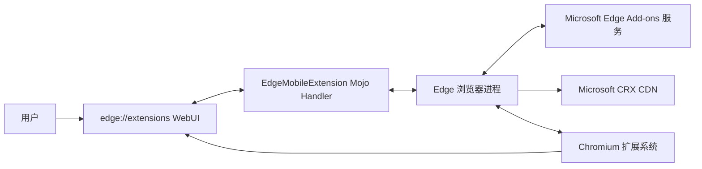
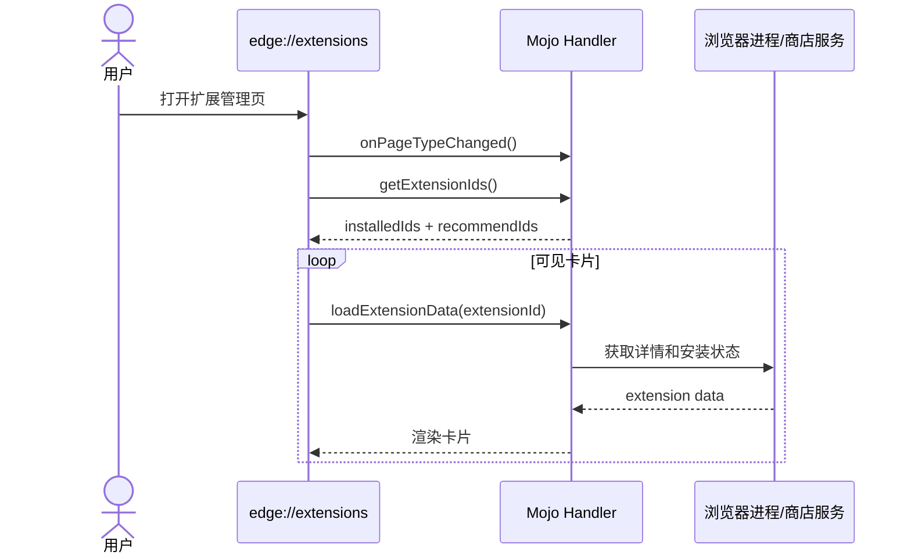
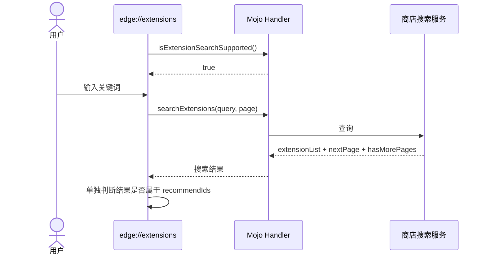
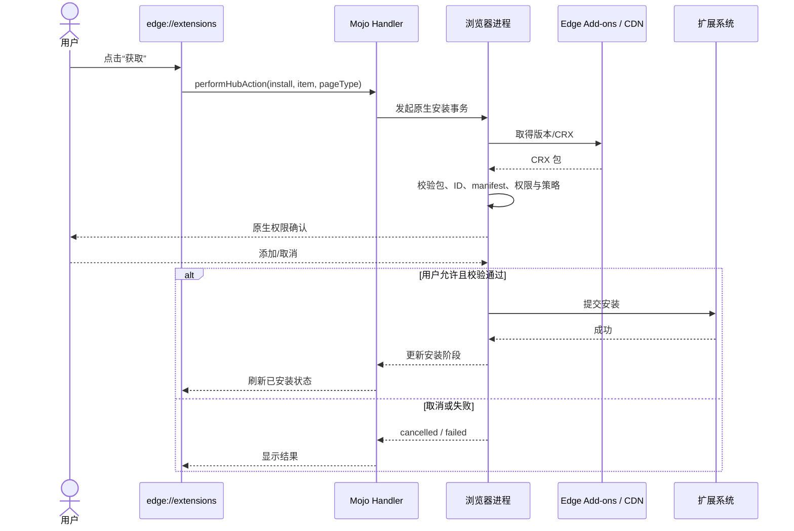

# Microsoft Edge Android 扩展实现调研报告

调研日期：2026-10-22（Asia/Hong_Kong）  
报告性质：单一版本、地区和设备环境的实现快照  
应用包：`com.microsoft.emmx`  
versionCode：`428304805`  
versionName：`155.0.4283.48`  
测试环境：Android 16 / API 36 / arm64-v8a / AVD `Arupa_Android_36_ARM64`

## 1. 执行摘要

Edge Android 155 已具备完整的移动扩展入口、内部管理页、推荐、搜索、详情、原生权限确认和扩展运行链路。其核心实现不是在普通 WebView 中打开 Edge Add-ons 网页，而是使用 `edge://extensions/` 内置 WebUI，通过 Mojo 调用浏览器进程，再由浏览器进程访问商店服务并驱动 Chromium 扩展系统。

本次调研得到的关键数据：

| 指标 | 结果 |
|---|---:|
| 客户端 `recommendIds` | 30 |
| 网页 `Edge_Android_Extensions` 集合 | 14 |
| 两个集合重合 | 12 |
| 网页集合独有 | 2 |
| 下载清单并集 | 32 |
| CRX 下载成功 | 32/32 |
| CRX3 容器 | 32/32 |
| 包内 MV3 / MV2 | 31 / 1 |
| 下载总大小 | 129,044,503 字节 |
| `uBlock Origin` 搜索结果 | 5 |
| 上述搜索结果属于推荐集合 | 0 |
| 完成安装与启动抽样 | 1（Dark Reader） |

最重要的结论是：

1. **客户端推荐、网页 Android 集合、普通搜索结果和已安装集合是不同口径。**
2. **能搜索到、显示“获取”或能下载 CRX，都不能单独证明扩展已在 Android 完整兼容。**
3. **页面只负责展示和发起动作，下载、校验、权限确认和安装结果由原生侧控制。**
4. **推荐集合会受版本、地区、渠道和远程配置影响，本报告不能外推为永久清单。**

## 2. 调研范围与方法

### 2.1 调研内容

- 检查 Edge Android 的扩展入口和 `edge://extensions/` UI。
- 读取内部页面脚本和生成的 Mojo 绑定。
- 调用可观察的页面接口，获取推荐 ID、搜索开关和搜索结果。
- 独立访问 Microsoft 公开商店集合、详情、搜索和 CRX 端点。
- 下载 CRX，检查容器、包内 manifest、版本、大小和 SHA-256。
- 从应用内推荐页安装 Dark Reader，观察权限确认、安装完成和启动结果。

### 2.2 证据等级

本文使用以下标记区分事实和推断：

| 标记 | 含义 |
|---|---|
| **直接观察** | 从 UI、CDP、内部脚本、Mojo 返回或本机包信息直接取得 |
| **独立验证** | 使用公开 Microsoft 地址发起无认证请求并验证响应/包 |
| **官方资料** | Microsoft 官方文档明确说明 |
| **机制推断** | 根据 Chromium 通用扩展机制推断，但本次未完整捕获 Edge Android 内部事务 |

涉及安装和更新时，本文会明确说明属于哪一种证据，避免把接口名称或通用机制误写成已经抓到完整调用链。

## 3. 环境与快照边界

### 3.1 应用版本

本机再次确认：

```text
packageName  = com.microsoft.emmx
versionCode  = 428304805
versionName  = 155.0.4283.48
```

Microsoft 移动稳定版发布说明显示，`.48` 发布于 2026-10-12；调研日期时发布记录中已有 `.61`（2026-10-19），且稳定版采用渐进发布。因此本报告只描述 `.48` 的精确快照。[Microsoft Edge Mobile Stable release notes](https://learn.microsoft.com/en-us/deployedge/microsoft-edge-relnote-mobile-stable-channel)

### 3.2 APK 记录

| 字段 | 值 |
|---|---|
| APK SHA-256 | `dfe4cd6aa81eb9f9f3b630411a6a68dfa23b75a1755d8810bdb75b2f9f061272` |
| 签名证书主体 | `Microsoft Corporation Third Party Marketplace (Do Not Trust)` |
| OU | `Microsoft Edge for Android` |
| 证书 SHA-256 | `01:E1:99:97:10:A8:2C:27:49:B4:D5:0C:44:5D:C8:5D:67:0B:61:36:08:9D:0A:76:6A:73:82:7C:82:A1:EA:C9` |

证书字段只用于锁定本次 APK 样本，不能据此推断其他渠道包具有相同签名链。

## 4. “支持”的口径

为了避免把搜索空间当成兼容清单，本报告采用分级口径：

| 等级 | 定义 | 数量 | 结论强度 |
|---|---|---:|---|
| A | Edge Android `.48` 的 `recommendIds` | 30 | 当前客户端明确推荐，但不是逐项功能认证 |
| B | 只在网页 `Edge_Android_Extensions` 集合中出现 | 2 | 网页运营集合信号，不代表当前客户端推荐 |
| C | 移动搜索能返回，但不在 A/B 中 | 未枚举全集 | 仅表示可发现，不能声明 Android 支持 |
| D | 实际完成安装与启动抽样 | 1 | 对该扩展、该版本、该环境的运行证据 |

这些等级不是安全评级。即使是 A 级，也仍需按扩展版本检查实际 API、权限、页面和后台生命周期。

## 5. 总体实现架构

### 5.1 架构图



### 5.2 各层职责

| 层 | 直接观察到或可确定的职责 |
|---|---|
| `edge://extensions` | 渲染已安装、推荐、搜索、详情和安装阶段 |
| Mojo Handler | 接收页面调用，向浏览器进程转发动作并返回数据 |
| 浏览器进程 | 获取商店数据、执行策略、驱动下载和原生安装事务 |
| Edge Add-ons 服务 | 提供集合、搜索、详情和 CRX 更新数据 |
| Chromium 扩展系统 | 管理安装、启停、卸载、权限和运行时生命周期 |

`edge://extensions/` 使用 FAST Web Components，根组件为 `mobile-extensions`。重新加载页面时，CDP 可见 `edge://extensions/index.js`、`edge_mobile_extension.mojom-webui.js` 等内部资源。

扩展元数据经 Mojo/浏览器进程取得，不一定表现为页面上下文中的普通 XHR。Network 面板没有对应公开 HTTPS 请求，不能被解释为浏览器进程没有访问后端。

## 6. 页面加载、推荐与搜索

### 6.1 首次进入



**直接观察：**

- `getExtensionIds()` 返回 `installedIds` 和 `recommendIds`。
- 本次首次采集时 `installedIds` 为空，`recommendIds` 为 30 项。
- 推荐卡片按 10 个一页惰性实例化，详情通过 `loadExtensionData(id)` 填充。

### 6.2 集合关系

| 集合 | 来源 | 用途 | 是否等于已验证兼容 |
|---|---|---|:---:|
| `installedIds` | 客户端 | 当前配置已安装状态 | 否 |
| `recommendIds` | 客户端/远程配置 | 当前应用内推荐 | 否 |
| `searchExtensions` | 商店搜索 | 更大的发现空间 | 否 |
| `Edge_Android_Extensions` | 网页运营集合 | 网页 Android 专题 | 否 |

网页集合返回 14 项，客户端推荐 30 项，交集为 12 项。两项网页独有扩展为 AdGuard VPN 和 Browsec VPN。

### 6.3 搜索



以 `uBlock Origin` 为例，返回：

| 名称 | ID | 是否属于 30 个推荐 ID |
|---|---|:---:|
| uBlock Origin Lite | `cimighlppcgcoapaliogpjjdehbnofhn` | 否 |
| uBlock Origin Scope | `epeadigopeefdedphdmpknbpjjkijlla` | 否 |
| uBlock | `nffknjpglkklphnibdiadeeeeailfnog` | 否 |
| WebLock | `gncnaahfckklhmgeemjhoebmkeoailal` | 否 |
| UltraBlock | `lcohocmebkndjboepljjajkmkceooegb` | 否 |

该结果直接证明：移动端搜索范围大于客户端推荐集合。

## 7. 内部 Mojo 接口

从生成的绑定中观察到：

| 方法 | 可观察用途 | 证据范围 |
|---|---|---|
| `getExtensionIds()` | 获取已安装和推荐 ID | 已直接调用 |
| `loadExtensionData(extensionId)` | 加载卡片/详情数据 | 已直接观察页面使用 |
| `performHubAction(action, item, pageType)` | 触发 Hub 动作 | 从绑定和前端实现确认 |
| `onNavigateToDetailPage(...)` | 详情页导航处理/记录 | 从绑定确认 |
| `openUrl(url)` | 由原生侧打开 URL | 从绑定确认 |
| `showSnackBarWithMessage(...)` | 展示操作结果 | 从绑定确认 |
| `loadCrxPackage()` | CRX 包加载入口 | 从绑定确认；未独立记录全部调用参数 |
| `onPageTypeChanged()` | 页面类型通知 | 从绑定确认 |
| `getExtensionInstallPhase(id)` | 查询安装阶段 | 从绑定确认 |
| `isExtensionSearchSupported()` | 查询搜索开关 | 已直接调用，返回 `true` |
| `searchExtensions(query, page)` | 搜索与分页 | 已直接调用 |
| `recordSearchAction(...)` | 搜索行为记录 | 从绑定确认 |
| `recordMv2SunsetAction(...)` | MV2 退出相关行为记录 | 从绑定确认 |
| `convertToBase64(...)` | 展示数据转换 | 从绑定确认 |

这些接口说明页面只持有受限动作入口。实际 CRX 写入、扩展目录修改和安装提交没有暴露为普通网页能力。

## 8. 下载与安装实现

### 8.1 应用内安装时序

下图将直接观察与 Chromium 通用机制合并表达：



证据边界：

- 点击获取、原生权限确认、安装后进入已安装区：**直接观察**。
- `performHubAction`、`getExtensionInstallPhase`、`loadCrxPackage`：**内部绑定证据**。
- 浏览器进程对签名、ID、manifest 和权限的具体校验步骤：**Chromium 机制推断**；本次没有对每个内部校验函数进行插桩。
- 下节列出的 CRX 地址：**独立验证的公开端点**；由于元数据流在浏览器进程，不能声称已从页面 Network 面板抓到 Edge 安装事务使用的全部请求。

### 8.2 公开商店与 CRX 端点

| 用途 | 地址 |
|---|---|
| Android 集合 | `https://microsoftedge.microsoft.com/addons/getcuratedextensionslistv2/Edge_Android_Extensions` |
| 产品详情 | `https://microsoftedge.microsoft.com/addons/getproductdetailsbycrxid/{id}` |
| 商店搜索 | `https://microsoftedge.microsoft.com/addons/v4/getfilteredorderedsearch` |
| CRX | `https://edge.microsoft.com/extensionwebstorebase/v1/crx?response=redirect&x=id%3D{id}%26installsource%3Dondemand%26uc` |

上述地址均可在无需登录和会话 Cookie 的情况下访问。本次没有绕过认证、地区控制或其他访问限制。

前三个 JSON 接口属于可观察实现，不应被第三方当作长期稳定协议。Microsoft 官方文档确认 Edge Add-ons 更新服务基址是 `https://edge.microsoft.com/extensionwebstorebase/v1/crx`，但具体查询参数、重定向和 JSON Schema 仍可能变化。[Microsoft Edge extensions FAQ](https://learn.microsoft.com/en-us/deployedge/microsoft-edge-manage-extensions-faq)

### 8.3 Dark Reader 安装抽样

**直接观察：**

1. 从应用内推荐卡进入 Dark Reader。
2. 点击获取后出现“添加 Dark Reader?”原生权限确认。
3. 用户确认后，Dark Reader 出现在“已安装”区域。
4. 点击扩展后成功打开 Dark Reader 移动帮助页。

这证明该扩展在本次环境中完成了“发现 → 原生确认 → 安装 → 已安装列表 → 启动”的基本链路。它不能替代其余 29 个推荐扩展的逐项兼容测试。

## 9. 启用、停用、卸载与更新

### 9.1 启用、停用和卸载

`performHubAction(...)`、已安装区和管理 UI 表明相关动作由原生侧处理，页面在动作后重新加载状态。

本次没有完整执行停用、重新启用和卸载的全部错误分支。因此可以确认“接口和 UI 路径存在”，不能声称已经验证企业策略、用户取消和异常恢复等所有行为。

### 9.2 自动更新

本次 CDP/UI 采集没有完整捕获 Edge Android 后台自动更新事务。

可以确认：

- Edge Add-ons 官方更新服务基址如上。
- Chromium 扩展更新通常按扩展 ID、当前版本和更新清单选择更高版本。
- 更新包需要维持扩展身份和签名一致性。

不能从本次证据确定：

- Edge Android 是否使用移动专属更新参数。
- 推荐集合是否参与更新门禁。
- 灰度、回滚和权限升级的全部实现细节。

因此更新流程在本报告中只作为边界说明，不作为已完整逆向的结论。

## 10. 公开集合与扩展清单

### 10.1 应用内推荐 30 项

版本优先采用实际下载 CRX 内 `manifest.json`：

| # | 名称 | Edge 扩展 ID | CRX 版本 | Manifest | 开发者 |
|---:|---|---|---|---|---|
| 1 | 沉浸式翻译 - AI 双语网页翻译 / PDF / 视频 / 漫画翻译 | `amkbmndfnliijdhojkpoglbnaaahippg` | 1.34.3 | MV3 | Immersive Translate |
| 2 | 篡改猴 | `iikmkjmpaadaobahmlepeloendndfphd` | 5.5.1 | MV3 | Jan Biniok |
| 3 | Dark Reader | `ifoakfbpdcdoeenechcleahebpibofpc` | 4.9.133 | MV3 | alexanderby |
| 4 | Global Speed: 视频速度控制 | `mjhlabbcmjflkpjknnicihkfnmbdfced` | 3.4.124 | MV3 | polywock |
| 5 | FetchV - M3U8/HLS视频下载器 | `dbepbhhcmhodojepbagfppgpieeplpik` | 3.2 | MV3 | FetchV Video Downloader |
| 6 | AIX智能下载器 | `pljfekbkmmbkdfhddpebdlmfngigcohc` | 9.0.58 | MV3 | aixdownloader |
| 7 | 猫抓 | `oohmdefbjalncfplafanlagojlakmjci` | 2.7.2 | MV3 | 笨猫猫 |
| 8 | I don't care about cookies | `oholpbloipjbbhlhohaebmieiiieioal` | 3.6.0 | MV3 | AVAST Software |
| 9 | SponsorBlock for YouTube | `mbmgnelfcpoecdepckhlhegpcehmpmji` | 6.1.6 | MV3 | Ajay Ramachandran |
| 10 | Ghostery 隐私广告拦截工具 | `fclbdkbhjlgkbpfldjodgjncejkkjcme` | 10.6.8 | MV3 | Ghostery GmbH |
| 11 | Unhook | `hebpjnnclppdnfghdnmhgdljmjpfhggk` | 1.6.9 | MV3 | Unhook |
| 12 | Bitwarden Password Manager | `jbkfoedolllekgbhcbcoahefnbanhhlh` | 2026.10.0 | MV3 | Bitwarden Inc |
| 13 | Cookie-Editor | `neaplmfkghagebokkhpjpoebhdledlfi` | 1.13.0 | MV3 | cgagnier |
| 14 | 脚本猫 | `liilgpjgabokdklappibcjfablkpcekh` | 1.4.0 | MV3 | 王一之 |
| 15 | Keepa - Amazon Price Tracker | `ejefaeioamebhekmfaclajddbpnnobje` | 5.72 | MV3 | Keepa |
| 16 | 暴力猴 | `eeagobfjdenkkddmbclomhiblgggliao` | 2.49.0 | MV3 | Gerald Liu |
| 17 | 隐私獾 | `mkejgcgkdlddbggjhhflekkondicpnop` | 2026.9.15 | MV3 | Electronic Frontier Foundation |
| 18 | SteamDB | `hjknpdomhlodgaebegjopkmfafjpbblg` | 4.37 | MV3 | xPaw |
| 19 | Coupert For Mobile | `fmpfpenogeehkhmffbjhhigdelkclhcl` | 6.5.4 | MV3 | Coupert Science LLC |
| 20 | Location Guard | `hbgdpjpeeodeojjbeenfnpnldhahleoo` | 2.5.0 | MV2 | Kostas Chatzikokolakis |
| 21 | Raindrop.io | `lpngnnjemnkjmgpoolldhiejhkmmgfge` | 6.8.2 | MV3 | Raindrop.io |
| 22 | Auto Refresh Plus \| Page Monitor | `oiecibnnapjeijccpmhonpooadjpcmnk` | 9.2.0 | MV3 | Autorefresh |
| 23 | Blue Marble | `kdmbopkfflgpmjhkcokgnnmkegaaamef` | 0.82.0 | MV3 | Fortune |
| 24 | MetaMask | `ejbalbakoplchlghecdalmeeeajnimhm` | 13.49.0.0 | MV3 | Consensys |
| 25 | User-Agent Switcher and Manager | `cnjkedgepfdpdbnepgmajmmjdjkjnifa` | 0.7.2 | MV3 | Bermet |
| 26 | 五彩 - 网页划线高亮批注工具 | `gomphpadgmilcnpnelambpopcbkfkgdo` | 26.10.3 | MV3 | 五彩科技 |
| 27 | Trancy - AI 网页 & YouTube 字幕翻译（手机版） | `oomajmgkhamjhobdlibpaoljemjamffa` | 4.3.0 | MV3 | Trancy |
| 28 | Cluing - AI Knowledge Base | `oaaidbemenheminahjaojcafppklekjd` | 3.58.3.1 | MV3 | Collabwriting |
| 29 | Buyhatke: 价格历史与追踪器 | `gdgnlfdenkmjcfgjpnookbglpndleahm` | 5.1.172 | MV3 | Buyhatke Internet Pvt Ltd |
| 30 | Distill Web Monitor | `hldhhgncaohjmpcjjhggekonocabhceg` | 4.2.21 | MV3 | Neemb Web Services Pvt. Ltd. |

### 10.2 网页 Android 集合独有 2 项

| 名称 | Edge 扩展 ID | CRX 版本 | Manifest | 开发者 |
|---|---|---|---|---|
| AdGuard VPN | `bkcoaehlnhbggcbmohegigjfgfdiihmp` | 2.11.1 | MV3 | AdGuard |
| Browsec VPN | `fjnehcbecaggobjholekjijaaekbnlgj` | 4.0.0 | MV3 | Browsec LLC |

## 11. CRX 下载与一致性校验

### 11.1 下载结果

- 32/32 下载成功，0 失败。
- 32/32 为 CRX3 容器。
- 31 个包为 Manifest V3，Location Guard 为 Manifest V2。
- 总大小为 `129,044,503` 字节。
- 所有包均记录请求 URL、最终 CDN URL、字节数和 SHA-256。
- 版本以包内 `manifest.json` 为最终记录来源。

### 11.2 版本差异

| 扩展 | 详情元数据版本 | CRX manifest 版本 | 结果 |
|---|---|---|---|
| Raindrop.io | `5.8.2` | `6.8.2` | 不一致 |
| MetaMask | `13.49.0` | `13.49.0.0` | 文本不一致 |

这说明商店详情只能用于展示和预检。真正安装时必须重新读取 CRX 内 manifest，并校验签名、ID、版本和预期包哈希。

## 12. 平台能力与企业策略

Microsoft 官方 API 矩阵表明 Android 只支持桌面扩展 API 的子集。例如 `action`、`alarms`、`cookies`、`declarativeNetRequest`、`downloads`、`management`、`scripting` 等包含 Android，而 `bookmarks`、`commands`、`contextMenus`、`debugger`、DevTools 和 `sidePanel` 等不包含 Android。[Microsoft Edge extension API support](https://learn.microsoft.com/en-us/microsoft-edge/extensions/developer-guide/api-support)

因此：

- 来源商店的“移动集合”或客户端推荐仍不能替代 API 能力检测。
- 每个 CRX 版本需要重新分析 manifest、代码、权限和 UI Surface。
- 支持某个 API 命名空间也不保证所有方法、规则上限和后台生命周期完全一致。

企业环境可以通过 `EdgeDisabledFeatures=extensions` 禁用 Android 扩展；官方标注该策略自 Android Edge 122 起支持。[Microsoft Edge Mobile Policies](https://learn.microsoft.com/en-us/deployedge/microsoft-edge-mobile-policies#edgedisabledfeatures)

## 13. 证据文件与复现

原始调研产物中的主要文件：

| 文件 | 内容 |
|---|---|
| `extensions-final.csv/json` | 32 项最终清单、版本、hash 和集合标记 |
| `download-results.json` | 逐项 CRX 下载结果 |
| `crx/` | 32 个 CRX 文件 |
| `evidence/raw/edge-android-recommended.json` | 30 个推荐 ID、搜索开关和搜索对照 |
| `evidence/raw/edge-store-android-collection.json` | 网页 Android 集合快照 |
| `evidence/raw/edge-mobile-extension-mojom.js` | 内部 Mojo 绑定 |
| `evidence/raw/edge-extensions-index.js` | 扩展页前端实现 |
| `evidence/raw/edge-extensions-network-filtered.json` | 内部页面请求记录 |
| `evidence/raw/edge-package-metadata.txt` | APK 和签名信息 |
| `evidence/ui/` | 推荐、权限确认、安装完成和运行截图 |
| `scripts/` | 采集、枚举、合并与下载脚本 |

典型复现顺序（原始 `outputs/` 目录）：

```bash
scripts/capture_edge_android.sh evidence/raw/edge-android-recommended.json
python3 scripts/enumerate_store_collection.py \
  --json evidence/raw/edge-store-android-collection.json \
  --csv evidence/raw/edge-store-android-collection.csv
python3 scripts/build_inventory.py \
  evidence/raw/edge-android-recommended.json \
  evidence/raw/edge-store-android-collection.json \
  --json extensions.json --csv extensions.csv
python3 scripts/download_crx.py extensions.json \
  --directory crx --results download-results.json
python3 scripts/merge_download_results.py extensions.json download-results.json \
  --json extensions-final.json --csv extensions-final.csv
```

注意：上述证据路径描述原始调研输出结构；如果只复制本文档到其他仓库，相关文件不会自动随文档存在。

## 14. 结论可信度

| 结论 | 证据 | 可信度 |
|---|---|:---:|
| 内部 WebUI + Mojo 架构 | 内部脚本、CDP、生成绑定 | 高 |
| 30 个客户端推荐 ID | `getExtensionIds()` 返回 | 高 |
| 搜索开关与搜索结果 | 直接调用 Mojo 方法 | 高 |
| 网页 Android 集合 14 项 | 公开接口快照 | 高 |
| 32 项 CRX 可公开下载 | 实际下载、hash 和 manifest | 高 |
| Dark Reader 基本安装/启动 | 实际 UI 操作 | 高 |
| 其他 29 个推荐项完整兼容 | 未逐项运行 | 未验证 |
| 启停/卸载全部分支 | 接口存在，但未完整操作 | 部分验证 |
| Android 自动更新完整实现 | 官方地址 + Chromium 机制 | 推断 |
| 所有地区/后续版本集合相同 | 与动态配置特性冲突 | 不成立 |

## 15. 局限与合规边界

- 只在一个 `zh-CN/CN` 配置、一个 Android 16 AVD 和 Edge `.48` 上采样。
- 只对 Dark Reader 完成安装与启动抽样。
- 没有逐项审计其余扩展的功能、权限、兼容性、安全性、耗电和后台行为。
- 没有穷举商店搜索空间，因为搜索命中不等于 Android 支持。
- CRX 可公开下载只说明分发端点可用，不表示所有功能均可运行，也不自动授予再分发权。
- 本次没有绕过认证、复制私有扩展或访问受保护内容。
- 微软可以调整推荐集合、搜索开关、接口 Schema、CRX 重定向和地区策略。

## 16. 对 Nomad 设计的输入

本报告只描述 Edge Android 事实，不在此定义 Nomad 产品需求。对 Nomad 的直接输入是：

1. Android 使用内部 Hub，普通商店网页不直接获得完整安装权限。
2. 推荐、搜索、已安装、可安装和已验证必须是独立字段。
3. 商店详情和来源标签不能替代对实际 CRX 的签名、manifest 和 API 能力检查。
4. 每个新版本都需要重新评估 Android 能力；搜索结果不自动获得 Android 适用标签。
5. 外部商店适配器必须隔离、可熔断，并遵守来源条款和再分发边界。

完整需求见 [Nomad 扩展商店自建需求设计](Nomad扩展商店自建需求设计.md)。

## 17. 参考资料

- [Microsoft Edge Mobile Stable release notes](https://learn.microsoft.com/en-us/deployedge/microsoft-edge-relnote-mobile-stable-channel)
- [Microsoft Edge extension API support](https://learn.microsoft.com/en-us/microsoft-edge/extensions/developer-guide/api-support)
- [Microsoft Edge Mobile Policies](https://learn.microsoft.com/en-us/deployedge/microsoft-edge-mobile-policies#edgedisabledfeatures)
- [Microsoft Edge extensions FAQ](https://learn.microsoft.com/en-us/deployedge/microsoft-edge-manage-extensions-faq)
- [Microsoft Edge self-hosted extension updates](https://learn.microsoft.com/en-us/microsoft-edge/extensions/update/auto-update)

