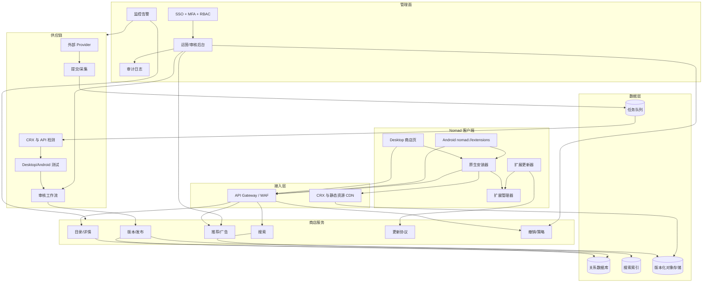
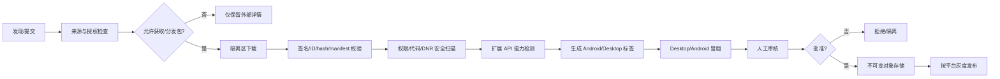
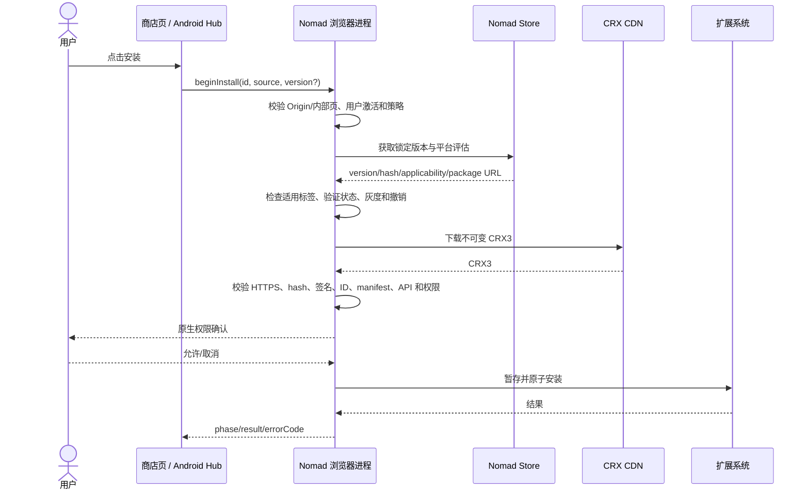

# Nomad 扩展商店自建需求设计

日期：2026-10-22  
文档状态：需求与总体设计基线  
适用范围：Nomad（逐风 / ARUPA）Desktop、Android、商店服务和管理后台

## 1. 建设目标

建设 Nomad 自有扩展商店 `https://webstore.zfbrowser.com`，让 Nomad Desktop 与 Android 用户能够：

- 浏览、搜索和查看扩展详情。
- 明确识别扩展适用于 Android 还是仅适用于 Desktop。
- 通过浏览器原生流程安装、升级、启用、停用和卸载扩展。
- 获得版本更新、安全下架、恶意撤销和失败回滚保护。

商店同时为运营、审核和安全团队提供扩展导入、API 能力检测、兼容性审核、推荐、广告、发布、更新、撤销和审计后台。


## 2. 已有基础

### 2.1 内核能力

按 `内核扩展支持能力.md` 当前表格逐行统计：

| 平台 | 支持的 API 数量 | 定位 |
|---|---:|---|
| Desktop | 64 | 接近完整 Chromium 扩展体验 |
| Android | 31 | 支持移动端核心扩展能力，不支持多种桌面 UI 和系统能力 |

能力矩阵必须版本化。后续内核新增、删除或部分实现 API 时，商店能够重新评估受影响扩展，不能把 64/31 永久硬编码在前端。

### 2.2 当前 Demo

本仓库已具备：

- 本地 CRX3 目录与包下载。
- CRX3 ID、版本、SHA-256、manifest 和本地化名称解析。
- Desktop `beginInstallWithManifest3` / `completeInstall` 安装流程。
- `checkUpdate` / `applyUpdate` 升级流程。
- `chrome.management.uninstall` 原生确认卸载。

Demo 可以作为 Desktop 联调基线，但本地 HTTP、可变包地址和页面提供完整 manifest 不能直接成为生产信任边界。

## 3. 核心产品原则

1. **展示与安装分离**：商店网页负责展示，浏览器进程负责下载、校验、权限确认和安装事务。
2. **版本级能力检测**：每个新版本都重新扫描，Android/Desktop 标签属于版本，而不是永久属于扩展。
3. **平台标签由能力集合决定**：全部所需能力属于 Android 31 项时标记 Android 适用；否则在 Desktop 64 项内标记 Desktop 适用。
4. **未知能力不乐观放行**：检测不到、动态构造或两端均不支持的能力进入人工审核，不默认归为 Android 或 Desktop。
5. **包不可变**：一个 `extension_id + version + sha256` 永远对应同一份 CRX 字节。
6. **CRX 身份可信**：浏览器重新验证签名、扩展 ID、实际 manifest、版本和权限。
7. **推荐和广告不能绕过审核**：只有已发布且对应平台可安装的版本才能投放。
8. **外部来源只是供应源**：Google/Edge 标签不能替代 Nomad 自己的检测、审核和安全责任。
9. **不绕过访问控制**：不抓取私有扩展，不绕过认证、令牌、地区限制或其他保护。

## 4. 应用适用标签与扩展 API 检测

这是扩展进入商店的必经步骤。

### 4.1 Android 31 项能力集合

当前 Android 支持集合：

```text
action
alarms
browserAction
browsingData
contentSettings
cookies
declarativeContent
declarativeNetRequest
dom
downloads
extension
history
i18n
identity
idle
management
notifications
offscreen
pageAction
permissions
runtime
scripting
search
sessions
storage
system.cpu
system.memory
tabs
userScripts
webNavigation
webRequest
```

注意：`browserAction` 和 `pageAction` 是 MV2 能力。Android 首期若执行 MV3-only 策略，这两个 API 即使在能力表中也不能让 MV2 包通过安装门禁。

### 4.2 检测范围

检测器不能只读取 `manifest.permissions`，必须组合以下信号：

1. **Manifest 声明**
   - `permissions`、`optional_permissions`。
   - `host_permissions`、`optional_host_permissions`。
   - `background.service_worker`、`action`、`commands`、`omnibox`、`side_panel`。
   - `devtools_page`、`content_scripts`、`declarative_net_request`。
   - `minimum_chrome_version`、`manifest_version` 和 CSP。
2. **JavaScript/TypeScript 静态分析**
   - `chrome.tabs`、`browser.tabs` 等成员访问。
   - 解构、别名、可选链和 Promise/回调形式。
   - 动态属性访问，如 `chrome[apiName]`，应标记为未知而不是忽略。
3. **HTML 与资源引用**
   - popup、options、offscreen、DevTools、side panel 和沙箱页面。
4. **DNR 和网络能力**
   - 静态/动态规则数、正则、响应头匹配、资源大小和内核限额。
5. **运行时冒烟结果**
   - 实际调用的 API、未实现错误、崩溃和权限申请。

Host 权限不是 API 命名空间，但仍需单独做风险与策略检查。

### 4.3 Manifest Surface 映射

部分平台依赖不会直接出现为 `chrome.*` 调用，检测器需要映射为能力：

| Manifest/资源 | 映射能力 | Android 当前结果 |
|---|---|---|
| `action` | `action` | 支持 |
| `background.service_worker` | `runtime` / MV3 后台生命周期 | 支持，但需冒烟 |
| `commands` | `commands` | 不支持 |
| `omnibox` | `omnibox` | 不支持 |
| `side_panel` | `sidePanel` | 不支持 |
| `devtools_page` | `devtools.*` | 不支持 |
| 右键菜单调用 | `contextMenus` | 不支持 |
| `declarative_net_request` | `declarativeNetRequest` | 支持，但需检查规则限制 |
| `offscreen_documents`/调用 | `offscreen` | 支持，但需版本门禁 |

### 4.4 标签判定算法

设：

- `R`：该版本检测出的必需能力集合。
- `O`：可选能力集合；不影响基本标签，但决定“功能受限”提示。
- `A(version)`：指定能力矩阵版本下的 Android 支持集合，当前为 31 项。
- `D(version)`：指定能力矩阵版本下的 Desktop 支持集合，当前为 64 项。
- `U`：无法解析、动态构造或尚未登记的能力集合。

判定顺序：

```text
if 包/manifest/签名无效:
    status = blocked
elif U 非空:
    applicability = manual_review
elif Android 执行 MV3-only 且 manifest_version != 3:
    applicability = desktop_applicable（前提是 R ⊆ D）
elif R ⊆ A:
    applicability = android_applicable
    desktop_compatible = true
    android_compatible = true
elif R ⊆ D:
    applicability = desktop_applicable
    desktop_compatible = true
    android_compatible = false
else:
    applicability = unsupported_or_manual_review
```

这满足业务要求：

- 扩展使用的 API **全部属于 Android 31 项**：标记 `Android 适用`。
- 只要存在 Android 不支持、但 Desktop 支持的 API：标记 `Desktop 适用`。
- 存在 Desktop 也不支持或检测器无法确认的 API：不得错误标为 Desktop，进入“不支持/人工审核”。

`Android 适用` 表示该版本具备 Android 安装资格，并不表示只能在 Android 使用。因为 Android 31 项通常也是 Desktop 能力子集，数据层应同时保存 `desktop_compatible=true`；商店主标签可按需求显示“Android 适用”，详情页可显示 Desktop、Android 两个平台徽章。

### 4.5 必需能力和可选能力

- `permissions` 中声明且代码必经路径使用的能力归入 `R`。
- `optional_permissions` 和可选功能分支归入 `O`。
- 如果 `R ⊆ A`、但 `O` 中存在 Desktop-only API，可以标记 `Android 适用（部分可选功能不可用）`，状态为 `limited`。
- 如果无法证明 Desktop-only API 只存在于可选路径，应保守地归入 `R`，标记 Desktop 适用或人工审核。

### 4.6 扫描输出

每个版本生成机器可读报告：

```json
{
  "extensionId": "aaaaaaaaaaaaaaaaaaaaaaaaaaaaaaaa",
  "version": "1.2.3",
  "packageSha256": "<sha256>",
  "manifestVersion": 3,
  "capabilityMatrixVersion": "2026-10-22.1",
  "requiredApis": ["action", "storage", "tabs"],
  "optionalApis": ["downloads"],
  "unknownApis": [],
  "manifestSurfaces": ["action", "background.service_worker"],
  "applicability": "android_applicable",
  "platforms": {
    "desktop": {"compatible": true, "status": "compatible"},
    "android": {"compatible": true, "status": "compatible"}
  },
  "limitations": [],
  "evidence": [
    {"api": "tabs", "file": "service_worker.js", "line": 27}
  ],
  "confidence": "high"
}
```

报告必须能定位 API 的文件和行号，供审核员复核。生产商店只展示摘要，不公开完整源代码或敏感扫描细节。

### 4.7 检测置信度

| 等级 | 条件 | 发布要求 |
|---|---|---|
| `high` | manifest 和 AST 可完整解析，无动态 API，无未知能力 | 可进入自动兼容门禁 |
| `medium` | 存在可选分支、压缩代码或部分无法追踪别名 | 需要人工抽查或动态冒烟 |
| `low` | 混淆、动态拼接 API、远程配置决定调用 | 必须人工审核，不自动给 Android 标签 |

静态扫描通过只能得到 `compatible`，不能直接得到 `verified`。`verified` 需要在指定 Nomad/内核版本完成运行测试。

### 4.8 新版本与标签变化

每次导入新版本都重新检测：

- Android 适用 → Android 适用：正常走更新审核。
- Android 适用 → Desktop 适用：Android 用户不得自动升级到新版本；保留最后一个 Android 兼容版本，并在后台告警。
- Desktop 适用 → Android 适用：完成 Android 冒烟后才开放 Android 发布。
- 任意状态 → 不支持/撤销：停止新安装，并根据风险决定暂停更新、停用或移除。

商店扩展级标签来自“当前对该平台公开的版本”，不能用历史上任意一个兼容版本推导。

### 4.9 后台人工覆盖

审核员可覆盖自动结果，但必须：

- 指定扩展版本、包 SHA-256、平台和能力矩阵版本。
- 填写理由、证据、适用 Nomad 版本范围和失效时间。
- 高风险或从“不支持”改为“Android 适用”时执行双人审批。
- 内核能力矩阵或扩展版本变化时自动失效并重新评估。

## 5. 功能需求

### 5.1 商店前台

- Desktop / Android 自适应首页。
- 分类、关键词搜索、分页、排序、专题和榜单。
- Desktop 推荐、Android 推荐、编辑精选和广告推荐。
- 扩展详情：名称、开发者、描述、截图、版本、来源、隐私政策、权限摘要和更新记录。
- 显示 `Android 适用`、`Desktop 适用`、`功能受限`、`待审核` 或 `不支持`。
- 已安装、当前版本、可升级和已停用状态由浏览器本地合并。
- 安装、升级、启停和卸载入口，但最终结果只来自原生扩展系统。
- 广告必须标注“广告/赞助”，且通过相同审核和平台门禁。
- 多语言、多地区、深浅色、键盘和读屏支持。

### 5.2 扩展详情和版本

每个扩展保存：

- 扩展 ID、名称、开发者、分类、标签和签名公钥指纹。
- 来源商店、上游 ID、上游详情 URL、更新时间和来源证据。
- 图标、截图、描述、隐私、主页和支持链接。
- 当前 Desktop/Android 公开版本和适用标签。
- 推荐、广告、下架、阻止和撤销状态。

每个版本保存：

- 版本、CRX 容器版本、Manifest 版本、SHA-256、大小和对象键。
- 包内 manifest、权限、Host 权限、DNR、Service Worker 和 UI Surface 摘要。
- API 检测报告、兼容矩阵版本、动态测试和人工审核记录。
- 获取来源、授权/再分发依据、发布、灰度、暂停、回滚和撤销记录。

### 5.3 更新与安全处置

- 自动更新与用户手动检查更新。
- 按 Desktop/Android、渠道、地区和百分比灰度。
- 最低浏览器版本、固定版本、暂停和回滚。
- 新增敏感权限时要求原生确认。
- 普通下架只阻止新安装；现有版本按策略继续运行。
- 安全处置支持阻止新安装、停止更新、强制停用和强制移除。
- 可按扩展、版本、包 SHA-256 或签名公钥撤销。

## 6. 商店总体架构



## 7. 扩展来源、同步与入库

### 7.1 来源

建议优先级：

1. Nomad 人工提交或未来的开发者提交。
2. Microsoft Edge Add-ons 公开且允许使用的来源。
3. Chrome Web Store；优先保留原详情链接或要求发布者提交，自动取包前必须完成条款评审。
4. 企业自托管源；使用独立信任策略，不与公众商店标识混用。

不使用第三方 CRX 下载站作为回退。

### 7.2 Provider

每个 Provider 只负责把上游转换成统一输入：

```text
上游 ID、详情 URL、名称、开发者、版本、更新时间
包获取方式、缓存/再分发权限、下架/恶意状态
来源证据、下次同步时间、错误和限流状态
```

Provider 必须支持域名白名单、超时、限流、指数退避、Schema 变化检测和一键熔断。

### 7.3 同步频率

| 类型 | 频率 |
|---|---|
| 安全撤销/上游恶意下架 | 1～6 小时或立即触发 |
| 热门/高安装量扩展 | 6～24 小时 |
| 普通扩展 | 保证每 7 天至少成功检查一次 |
| 人工立即同步 | 高优先级，但仍经过扫描和审核 |

不能只采用“每周随机更新”。调度器应维护 `next_sync_at`，在截止时间内加入抖动以平滑流量，同时保证每个扩展满足最大陈旧时间。

### 7.4 入库流水线



Nomad 包地址建议：

```text
https://cdn.webstore.zfbrowser.com/crx/{extension_id}/{version}/{sha256}.crx
```

Nomad 地址是自己的不可变地址，不需要与 Google/Edge 地址相同。上游 URL 作为来源证据保存；无再分发依据时不得复制到 Nomad CDN。

## 8. 后台管理需求

### 8.1 首页与待办

- 待扫描、待审核、同步失败、标签变化、灰度异常和高危告警。
- Provider 成功率、限流、熔断和数据陈旧度。
- Android/Desktop 适用扩展数及状态分布。
- 安装/更新失败码趋势和安全撤销执行状态。

### 8.2 扩展和版本管理

- 按 ID、名称、开发者、来源、平台标签、状态、权限和分类查询。
- 查看签名、上游映射、历史版本和历史标签。
- 编辑多语言详情、分类、隐私和支持链接。
- 版本对比，突出新增 API、权限、Host、DNR 和代码风险。
- 查看包 hash、manifest、API 检测证据、静态扫描和动态测试。
- 上架、暂停、灰度、回滚、下架、阻止和撤销。

### 8.3 API 能力检测工作台

- 维护带版本的 Desktop 64 / Android 31 能力矩阵。
- 支持 API 的 `supported`、`unsupported`、`partial`、最低内核版本和限制说明。
- 展示每个 API 的来源文件、行号、必需/可选和置信度。
- 显示自动标签判定过程：`R ⊆ A`、`R ⊆ D` 或未知能力。
- 重新运行指定版本扫描和指定 Nomad/Android 环境测试。
- 处理 Android → Desktop 标签退化告警。
- 人工覆盖带失效时间和双人审批。

### 8.4 审核工作台

- 自动检查清单和人工检查项。
- 普通、敏感权限、高风险、疑似恶意分级。
- 审核意见、证据附件、拒绝原因和重新提交。
- 能按 SHA-256 还原当时审核对象。
- 广告、强制停用/移除、签名撤销执行四眼审批。

### 8.5 推荐、专题和广告

- 按 Desktop/Android、地区、语言和渠道配置。
- 配置位置、时间窗、顺序、权重、图片和落地页。
- Android 推荐只允许 `android_applicable` 且已审核发布的版本。
- Desktop 推荐允许 `desktop_applicable` 或 `android_applicable`。
- 广告明确标识，不能覆盖兼容和撤销状态。

### 8.6 来源、同步和安全处置

- Provider 配置、域名白名单、速率、重试和熔断。
- 单项/批量导入、立即同步、计划任务和失败证据。
- 按扩展、版本、hash 或签名创建撤销。
- 动作包括阻止新安装、停止更新、强制停用、强制移除。
- 所有高风险操作记录操作者、审批人、理由和工单号。

### 8.7 权限与审计

- 企业 SSO、MFA、最小权限 RBAC。
- 角色：内容运营、来源运营、审核、安全、发布、系统管理员、只读审计。
- 发布、回滚、撤销、能力矩阵、人工标签和 Provider 变更写入不可变审计日志。

## 9. 数据模型

| 实体 | 关键字段 |
|---|---|
| `Extension` | ID、名称、开发者、签名、目录状态 |
| `ExtensionListing` | 语言/地区、描述、图标、截图、隐私/支持链接 |
| `Release` | 版本、hash、对象键、manifest、来源和发布状态 |
| `ApiCapability` | API、平台、支持状态、版本范围、限制 |
| `CapabilityMatrix` | 矩阵版本、平台、API 集合、发布时间 |
| `ApiDetectionReport` | 必需/可选/未知 API、证据、标签、置信度 |
| `PlatformAssessment` | 平台、兼容状态、测试环境、限制和证据 |
| `ProviderMapping` | Provider、上游 ID、URL 和同步策略 |
| `ReviewCase` | 扫描、人工结论、审批人和时间线 |
| `Rollout` | 平台、渠道、地区、比例和暂停状态 |
| `RecommendationSlot` | 页面、位置、平台、地区、时间和类型 |
| `Revocation` | 目标、动作、严重度、原因和有效期 |
| `AuditEvent` | 操作者、动作、对象、前后值摘要和工单 |

目录状态：

```text
DRAFT → INGESTING → SCANNING → REVIEW_PENDING → APPROVED → PUBLISHED
                         └────→ REJECTED
PUBLISHED → PAUSED → PUBLISHED
PUBLISHED → UNLISTED
PUBLISHED/UNLISTED → BLOCKED/REVOKED
```

平台验证状态与适用标签分开：

| 字段 | 值 | 含义 |
|---|---|---|
| `applicability` | `android_applicable` / `desktop_applicable` / `manual_review` / `unsupported` | API 能力分类 |
| `verification` | `verified` / `compatible` / `limited` / `unverified` / `blocked` | 审核和运行验证结论 |

## 10. 服务 API

### 10.1 浏览 API

| 方法 | 路径 | 用途 |
|---|---|---|
| `GET` | `/v1/bootstrap` | 配置、能力协议版本、功能开关 |
| `GET` | `/v1/extensions` | 分类/推荐列表和平台过滤 |
| `GET` | `/v1/search` | 搜索、游标和适用标签 |
| `GET` | `/v1/extensions/{id}` | 详情、来源、权限和平台结论 |
| `GET` | `/v1/extensions/{id}/releases/{version}` | 锁定版本元数据 |
| `GET` | `/v1/recommendations` | 推荐、专题和广告位 |

### 10.2 包、更新和撤销 API

| 方法 | 路径 | 用途 |
|---|---|---|
| `GET` | `/crx/{id}/{version}/{sha256}.crx` | 不可变 CRX3 |
| `GET/POST` | `/service/update2/crx` | Chromium 兼容更新检查 |
| `GET` | `/v1/revocations` | 签名的撤销摘要 |
| `GET` | `/v1/client-policy` | 平台/渠道商店策略 |

CRX 响应：

```http
Content-Type: application/x-chrome-extension
Cache-Control: public, max-age=31536000, immutable
ETag: "<sha256>"
X-Content-Type-Options: nosniff
```

更新 XML 示例：

```xml
<?xml version="1.0" encoding="UTF-8"?>
<gupdate xmlns="http://www.google.com/update2/response" protocol="2.0">
  <app appid="aaaaaaaaaaaaaaaaaaaaaaaaaaaaaaaa" status="ok">
    <updatecheck
      status="ok"
      codebase="https://cdn.webstore.zfbrowser.com/crx/aaaaaaaaaaaaaaaaaaaaaaaaaaaaaaaa/1.2.3/sha256.crx"
      version="1.2.3"
      prodversionmin="1.0.0" />
  </app>
</gupdate>
```

客户端附带平台、架构、Nomad 版本和渠道，使服务不会向 Android 返回 Desktop-only 版本。自动更新不依赖 Cookie。

### 10.3 管理 API

```text
POST   /admin/v1/imports
GET    /admin/v1/sync-jobs
POST   /admin/v1/sync-jobs/{id}/retry
GET    /admin/v1/releases/{id}/api-report
POST   /admin/v1/releases/{id}/rescan
POST   /admin/v1/assessments/{id}/override
POST   /admin/v1/reviews/{id}/approve
POST   /admin/v1/reviews/{id}/reject
POST   /admin/v1/releases/{id}/publish
POST   /admin/v1/releases/{id}/pause
POST   /admin/v1/releases/{id}/rollback
POST   /admin/v1/revocations
PUT    /admin/v1/recommendation-slots/{id}
GET    /admin/v1/audit-events
```

管理写请求必须带操作者、幂等键和审计上下文；高风险操作通过审批工作流生效。

## 11. 浏览器侧流程

### 11.1 访问商店

#### Desktop

1. 从菜单或地址栏打开固定 HTTPS Origin `https://webstore.zfbrowser.com`。
2. 商店读取平台、Nomad 版本、渠道、架构、语言和能力矩阵版本。
3. 服务返回 Desktop 可见目录；Android 适用版本也可在 Desktop 安装。
4. 浏览器本地合并已安装版本、启用状态和可更新状态。
5. 特权安装接口仅允许精确 Origin、顶层 Frame、正常模式和有效用户点击。

#### Android

1. 从菜单进入 `nomad://extensions`。
2. 内部 Hub 展示已安装、Android 推荐和搜索。
3. 搜索结果根据 `applicability` 显示标签。
4. 只有 `android_applicable` 且验证状态允许的版本显示安装按钮。
5. 公开商店页的安装按钮跳转内部详情，或调用只接受 `id/source` 的窄桥接；不暴露完整 `webstorePrivate`。

### 11.2 安装



阶段机：

```text
IDLE
→ RESOLVING_METADATA
→ CHECKING_POLICY
→ CHECKING_COMPATIBILITY
→ DOWNLOADING
→ VERIFYING_PACKAGE
→ AWAITING_USER_CONSENT
→ INSTALLING
→ INSTALLED
```

失败进入 `CANCELLED`、`FAILED(errorCode)` 或 `ROLLING_BACK`。页面不能用“下载完成”代替安装成功。

Desktop 可适配现有 `beginInstallWithManifest3` / `completeInstall`，但浏览器必须重新获取可信元数据并解析包内 manifest。Android 建议接口：

```text
getExtensionIds()
loadExtensionData(id, platform)
searchExtensions(query, cursor)
beginInstall(id, source, version)
confirmInstall(transactionId)
getInstallPhase(id)
setEnabled(id, enabled)
uninstall(id)
```

### 11.3 升级

1. 更新器发送扩展 ID、当前版本、平台、Nomad 版本和渠道。
2. 服务选择未撤销、符合灰度且适用于当前平台的更高版本。
3. Android 只会收到 `android_applicable` 版本；若最新版退化为 Desktop-only，继续保留最后一个 Android 版本。
4. 下载不可变 CRX，重新校验同一 ID/作者签名、hash、manifest、API 标签和权限差异。
5. 无新增敏感权限时，在扩展空闲后原子更新。
6. 新增敏感权限、来源变化或其他风险变化时请求原生确认。
7. 失败保留/回滚旧版本并上报结构化错误码。

### 11.4 启用、停用和卸载

- 启停由本地扩展系统执行，商店没有远程启停写接口。
- 企业强制安装扩展可以禁止用户停用或卸载。
- 卸载从扩展管理页、Android Hub 或受信详情页发起，始终读取真实本地状态。
- 普通扩展显示原生确认；确认后停止运行并删除注册和文件。
- 商店只接收可选匿名结果事件，不决定卸载成功。
- 卸载一个设备上的扩展不会删除商店目录或其他设备安装。

`chrome.management.uninstall` 不能通过 `showConfirmDialog: false` 绕过 Nomad 的原生确认策略。

## 12. 安全、隐私与合规

### 12.1 客户端

- 生产特权 API 只信任固定 HTTPS Origin 或内部 WebUI。
- 拒绝 iframe、跨 Origin、无用户激活、隐身和失效标签页。
- 下载器限制 HTTPS 域名、重定向次数、包大小和 MIME，拒绝 HTTP 降级。
- 页面传入的 manifest、hash、权限和 URL 均视为不可信提示。
- 暂存、原子提交和旧版本回滚。

### 12.2 供应链

- 外部包先进入隔离区。
- 验证 CRX3 签名、ID、公钥、hash、manifest 和版本一致性。
- 检查压缩炸弹、路径穿越、远程代码、恶意代码、敏感权限和 DNR。
- API 检测报告和审核对象按包 hash 固定。
- 对发布元数据、对象存储和管理密钥实行最小权限和轮换。

### 12.3 外部来源

- 分别评审 Microsoft/Google 的技术接口、条款和再分发权限。
- 不绕过登录、Cookie、令牌、地区或其他访问控制。
- 无再分发依据时只保留来源详情或要求发布者提交。
- 同步上游下架和恶意处置，不只同步新版本。

### 12.4 隐私

- 浏览和更新默认不要求登录。
- 更新请求不依赖 Cookie 或跨站用户标识。
- 只采集最小化的阶段、错误码、平台和版本聚合指标。
- 搜索词去标识化并设置短保留期。

## 13. 非功能需求

| 类别 | 建议首期目标 |
|---|---|
| 可用性 | 目录/更新 API 99.9%，CRX CDN 99.95% |
| 性能 | 缓存命中时目录/详情 P95 < 500 ms，更新检查 P95 < 500 ms |
| 一致性 | 已发布 `id + version + hash` 永不覆盖 |
| 扩展性 | API 无状态扩容，采集/扫描/测试使用队列解耦 |
| 可观察性 | 指标、日志、追踪、阶段错误码和 Provider 陈旧告警 |
| 可恢复性 | 数据库备份、对象版本化、发布与撤销配置可恢复 |
| 国际化 | 多语言/地区回退，不改变 CRX 身份 |
| 无障碍 | 商店和后台支持键盘、读屏和足够对比度 |

## 14. 当前 Demo 到生产系统的差距

| 当前 Demo | 生产需求 |
|---|---|
| 回环 HTTP + 启动参数授权 | 固定 HTTPS Origin 和内置/签名权限配置 |
| 本地 `packages/` | 数据库、隔离区、对象存储和审核流 |
| `/api/catalog` | 分页、搜索、来源、适用标签和多语言 |
| `/api/package?id=` | `id/version/hash` 不可变地址 |
| 页面传完整 manifest | 原生侧重新取元数据并解析实际 CRX |
| 基础 CRX3 解析 | 完整签名、安全、API 能力和动态兼容检测 |
| 手动升级 | 更新协议、定时器、灰度、回滚和撤销 |
| 无 Android Hub | `nomad://extensions` + Mojo/JNI |
| 无后台 | 运营、审核、API 检测、来源、推荐、撤销、RBAC 和审计 |

## 15. 建设阶段

### Phase 0：能力检测和信任基线

- 把 Desktop 64 / Android 31 矩阵变成版本化机器数据。
- 实现 manifest + AST API 检测器和扫描报告。
- 定义适用标签、验证状态、错误码和安装状态机。
- 完成 CRX3 信任链、商店 Origin、外部来源和撤销威胁模型。

### Phase 1：Desktop MVP

- HTTPS 商店、目录、搜索、详情和不可变 CDN。
- Desktop 原生安装、卸载和更新协议。
- 内部后台支持导入、API 检测、审核、发布、暂停和回滚。

### Phase 2：Android Hub

- `nomad://extensions` 已安装、推荐、搜索和详情。
- Android 安装阶段机、权限确认、启停和卸载。
- Android 标签门禁和模拟器冒烟。

### Phase 3：Provider 与运营

- 先接 Edge Provider，再评估 Chrome Provider。
- 确定性同步、Schema 监控和熔断。
- 推荐、专题、广告和多地区运营。

### Phase 4：安全与生态

- 快速撤销、影响评估和复盘。
- 开发者认领、提交和审核反馈。
- 企业私有目录、强制安装和固定版本。

## 16. 验收标准

| 场景 | 预期 |
|---|---|
| 所有必需 API 都在 Android 31 集合 | 标记 Android 适用 |
| 存在 Android 不支持但 Desktop 支持的 API | 标记 Desktop 适用 |
| 存在两端均不支持或未知动态 API | 不自动贴标签，进入人工审核 |
| 只有可选功能使用 Desktop-only API | Android 适用 + 功能受限说明 |
| 新版本由 Android 适用退化为 Desktop 适用 | Android 不自动升级，保留上一兼容版本并告警 |
| 包 hash、ID、签名或 manifest 不一致 | 拒绝安装/升级 |
| 非官方 Origin、iframe 或无用户激活 | 拒绝调用特权安装接口 |
| 新增敏感权限 | 暂停自动更新并请求确认 |
| Provider 不可用 | Nomad 自有扩展不受影响 |
| 扩展被紧急撤销 | 按策略阻止、停用或移除 |
| 普通卸载 | 原生确认后卸载 |
| 企业强制扩展卸载 | 拒绝并显示策略原因 |

## 17. 待确认事项

1. Android 首期是否严格 MV3-only；本方案建议是。
2. `Android 适用` 是否在 UI 同时显示 Desktop 徽章，还是仅显示最宽平台标签。
3. `compatible` 是否允许 Android 用户安装；建议允许并提示未完整验证，`unverified` 不允许。
4. 静态扫描器选择现有 AST 工具还是内核侧编译期/运行时探针。
5. Android 标签退化时，上一兼容版本保留和安全补丁策略。
6. 外部包缓存与再分发由谁审批、证据保留多久。
7. 自动灰度阈值、崩溃阈值和自动暂停规则。
8. 安全撤销的强制停用/移除权限和双人审批范围。

## 18. 参考资料

- [Edge Android 扩展实现调研](Edge安卓扩展实现调研.md)
- [内核扩展支持能力](内核扩展支持能力.md)
- [Microsoft Edge 扩展 API 支持矩阵](https://learn.microsoft.com/microsoft-edge/extensions/developer-guide/api-support)
- [Microsoft Edge 自托管扩展自动更新](https://learn.microsoft.com/en-us/microsoft-edge/extensions/update/auto-update)
- [Microsoft Edge 扩展更新服务 FAQ](https://learn.microsoft.com/en-us/deployedge/microsoft-edge-manage-extensions-faq)
- [Microsoft Edge 自托管部署排障](https://learn.microsoft.com/en-us/troubleshoot/microsoft-edge/development/self-host-extension-deploy)
- [Chrome 扩展更新生命周期](https://developer.chrome.com/docs/extensions/develop/concepts/extensions-update-lifecycle)

