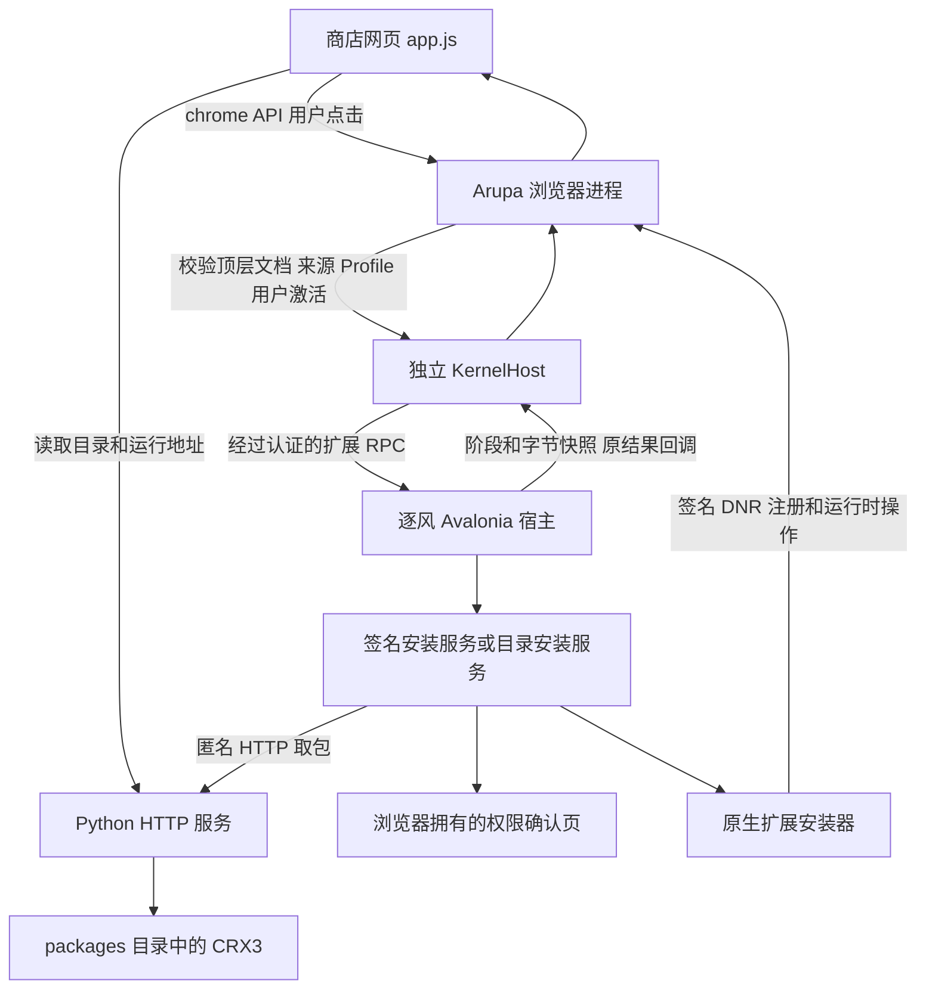
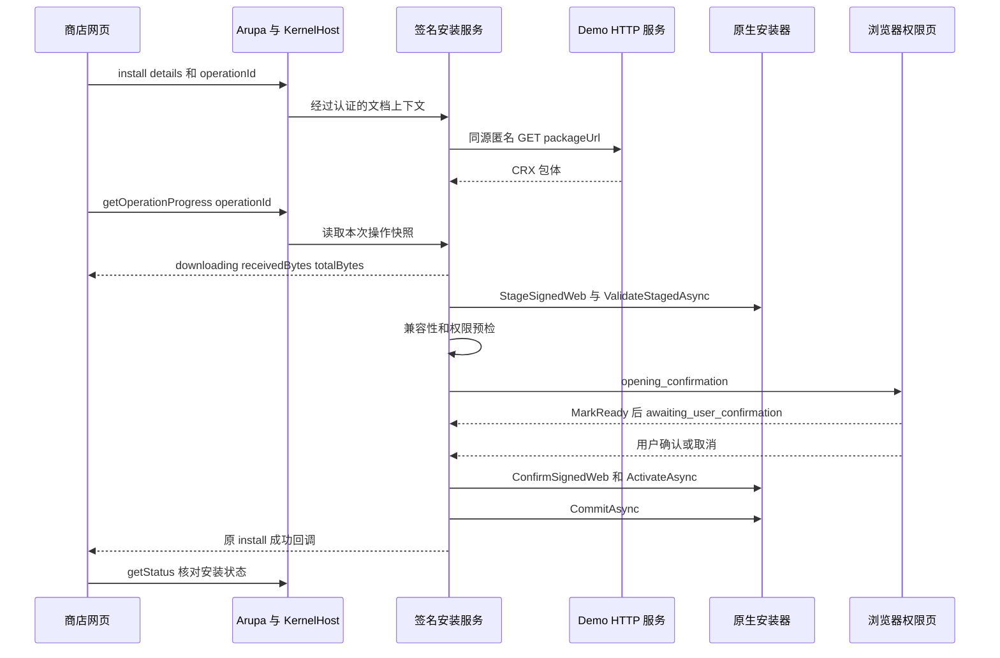

# 逐风扩展商店 Demo 技术文档

更新日期：2026-11-24，Asia/Hong_Kong。

本项目为桌面逐风浏览器提供 CRX3 目录、取包服务和网页安装交互。网页通过浏览器扩展安装 API 发起操作；逐风宿主负责下载、兼容性预检、权限确认和事务协调；Arupa 内核负责网页调用者身份、能力门禁、发布签名验证及扩展运行时能力。安装成功以浏览器完成提交并返回成功回执为准。

适用对象为商店前端、逐风宿主、内核和测试同事。以下内容描述当前源码实现；Android 和 iOS 涉及目录标签与前端识别，不代表已审计这两端浏览器的原生桥接实现。

## 1 源码范围

| 项目 | 本机源码目录 | 本次分析的提交基线 |
| --- | --- | --- |
| 商店 Demo | `/Users/flex/workplace/arupa_webstore_demo` | `c32b2713c0a015f9e880a0502bd4b78f12270917` 加缓存、流式取包及移除平台过滤的后续工作区改动 |
| Arupa 内核 | `/Users/flex/workplace/chromium/arupa_desktop` | `309c661c260c01bd8c074ad383e7d757ba32916c` |
| Nomad 宿主 | `/Users/flex/workplace/chromium/nomad_desktop` | `d19440952deafed0d12f8d0470f0a5e945b027df` |

实际宿主目录名为 `nomad_desktop`。Demo、宿主和内核需使用相互兼容的版本；网站更新不会给已安装的旧浏览器增加原生 API。

## 2 分层架构



安装 API 的请求先由内核认证，再经 KernelHost 转发到 UI 宿主；安装器调用内核能力时沿 OOP 通道返回。Python 服务不调用宿主安装器，也不接收安装、升级或卸载指令。

| 层级 | 主要职责 | 关键入口 |
| --- | --- | --- |
| 网页 | 选包、选择安装通道、保留点击激活、显示进度、核对回执和刷新状态 | [app.js][demo-app] |
| HTTP 服务 | 解析目录、按 ID 取包、摘要匹配、返回访问地址 | [server.py][demo-http]、[crx_catalog.py][demo-catalog] |
| Arupa | 注册网页可用 API、校验真实调用文档、构造可信上下文、检查精确宿主能力 | [API provider][kernel-provider]、[ArupaExtApiHost][kernel-host] |
| KernelHost 和 OOP | 接受空扩展 ID 的合法网页安装请求，维护请求和连接代际，转发认证消息 | [NativeExtensionHost][host-forward]、[OopKernelTransport][host-transport] |
| 逐风 UI 宿主 | 路由 API、调用安装服务、展示权限确认、刷新扩展列表 | [MainWindow.ChromeWebStore][host-ui] |
| 安装服务和安装器 | 下载、暂存、预检、确认、激活、提交、回滚和安装来源记录 | [签名安装服务][signed-service]、[目录安装服务][catalog-service]、[安装器][installer] |

## 3 两条网页安装通道

### 3.1 网页如何选择通道

[installMode][demo-mode] 先检查包是否有 `signedProduct`，再检查 `nomadSignedExtensions.install/getStatus/uninstall` 三个方法是否存在；满足条件就使用签名通道。否则检查 `webstorePrivate.beginInstallWithManifest3/completeInstall` 与 `management.getAll`，满足条件则使用目录通道。两条通道均不可用时不提供安装按钮。

进度 getter 不属于安装按钮的必需条件。浏览器能够安装但没有进度方法时，网页继续等待原结果回调，并显示能力限制。已经发出的签名安装报错后，Demo 不会自动换到另一通道重试。

| 项目 | 发布签名通道 | 本机目录通道 |
| --- | --- | --- |
| 新装入口 | `chrome.nomadSignedExtensions.install(details, callback)` | `chrome.webstorePrivate.beginInstallWithManifest3(details, callback)`，批准后调用 `completeInstall(id, callback)` |
| 页面来源 | 生产要求顶层 HTTPS；Test 环境额外允许 RFC1918 IPv4 HTTP | HTTP 18731，主机为 `127.0.0.1` 或 RFC1918 IPv4 |
| 公网随机 HTTPS 域名 | 可以使用，仍须满足同源取包和受信发布签名 | 不获得目录商店权限 |
| 包的要求 | CRX3 作者签名及受信 Ed25519 发布签名，MV3，身份和资源校验通过 | CRX3 作者签名、ID、MV3、manifest 预览、权限与 DNR 校验；MiVPN 另有准入检查 |
| 下载 URL | 网页传入与页面同源的 `packageUrl` | 宿主构造 `{origin}/api/package?id={id}` |
| 进度 getter | `nomadSignedExtensions.getOperationProgress` | `webstorePrivate.getOperationProgress` |
| 已安装状态 | `nomadSignedExtensions.getStatus` | `management.getAll`；内核还提供 `getExtensionStatus` |
| 网页卸载 | `nomadSignedExtensions.uninstall` | `management.uninstall` |
| 网页更新 | 当前没有 `checkUpdate/applyUpdate` | `webstorePrivate.checkUpdate/applyUpdate` |

目录通道由逐风启动的 KernelHost 设置固定 Demo 环境，renderer 使用对应 gallery 参数。它在 Production、Test、Development 中可用，不能笼统写成仅 Test 支持。`localhost`、其他 127/8 地址、IPv6、任意域名及其他 HTTP 端口均不满足当前目录商店规则。签名通道的 Test HTTP 规则允许 RFC1918 IPv4 的其他端口，但不包含 HTTP loopback。[内核来源规则][kernel-origin]、[宿主来源规则][signed-context]、[启动环境][host-env]。

### 3.2 可信上下文与能力登记

内核验证当前顶层主文档、renderer、Profile、是否无痕以及真实的瞬时用户激活。网页传入的布尔值不能代替用户激活。`install/uninstall` 要求点击；状态与进度查询不要求另一次点击；Worker 和无痕文档不能使用签名 API。

`TrustedContext` 中的 `contextType/profileId/documentId/origin/method` 由浏览器认证通道提供，网页不能用普通参数伪造。网页调用使用空 `ExtensionId`；KernelHost 和 UI transport 都对这一例外显式放行合法商店请求。

签名进度需要以下内容配套交付：

1. Arupa API schema 与网页绑定，包括 Chromium renderer 的 `kWebAvailableFeatures`。
2. 浏览器进程校验及 `arupa_exact_host_api_members.h` 中的精确成员。
3. Foundation 的 `NativeExtensionHostCapabilities`。
4. 共享 KernelHost 的 `NativeExtensionCapabilities`。
5. UI 宿主中的安装服务、进度记录及下载字节回报。

能力标识为 `extensions.signed_web_install_progress.v1`，复用既有 JSON RPC，没有新增公共 C ABI。仅有命名空间、schema 或内核 capability 标志不能证明宿主已登记 getter；漏登记可返回 `signed_extension_host_unavailable`。[网页绑定][renderer-binding]、[内核精确成员][kernel-members]、[Foundation 合同][host-capabilities]、[KernelHost 合同][kernelhost-capabilities]。

## 4 Demo 的 HTTP 协议与选包

### 4.1 HTTP 接口

| 方法和路径 | 作用 | 关键返回或限制 |
| --- | --- | --- |
| `GET /` | 商店页面 | 静态 `index.html` |
| `GET /docs` | 网页接口说明 | 静态 `api.html`；不等于开放整个 docs 目录 |
| `GET /api/catalog?platform=desktop&all=1` | 逐文件目录 | `{packages: [], errors: []}`；all=1 返回每个 CRX，附 isLatest 默认包标记；省略 all 仍每 ID 一个最高版本；platform 仅作提示 |
| `GET /api/package?id=...&file=...&platform=desktop&sha256=...` | 下载 CRX3 | ID 必填；file 可选，用目录文件名精确取包；省略 file 仍选默认包；platform、sha256 可省略；摘要为 64 位小写十六进制 |
| `HEAD /api/package?id=...` | 获取整包头信息 | 参数校验同 GET；忽略 Range；无包体 |
| `GET /api/health` | 存活与服务识别 | `{status: 'ok', service: 'arupa-webstore-demo'}` |
| `GET /api/runtime` | 当前访问地址和隧道状态 | `instanceId/localUrl/lanUrl/tunnel`；不返回控制 token |
| `POST /_control/stop` | 启停脚本停止服务 | 需要回环 Host、控制 token，且不能带 Origin 或 Sec-Fetch-Site；不是网页业务 API |

CRX 下载返回 `application/x-chrome-extension`，整包为 `200`，有效单段范围为 `206`。包接口的 HTTP 400 表示参数无效，404 表示当前目录没有对应 ID/文件组合，409 表示指定摘要不符或读包时内容变化，416 表示合法范围无法满足。file 禁止路径分隔符、NUL、空值及重复值，且只能选择目录索引中的真实文件，不能访问目录外路径。选中文件删除或变化时明确失败，不回退其他版本。浏览器仍验证包的完整性、签名和身份。

网页“下载 CRX”另加 download=1，成功响应改为 application/octet-stream 并附 Content-Disposition: attachment、ASCII 回退文件名和 UTF-8 filename*；正文仍为所选原始 CRX，摘要及续传语义不变。错误响应不附附件名。原生安装/升级 URL 不带该参数，继续使用 CRX MIME。点击提示只是已请求浏览器下载；真实进度、保存位置和完成状态由浏览器管理，不能把 HTTP 200 或网页提示当作文件落盘。

所有响应使用 `Cache-Control: no-store` 和 `nosniff`，CRX 额外使用 `no-transform`。页面 CSP 允许同源脚本、样式和连接，禁止 object 与嵌入。静态页面、health 和 runtime 当前不接受 query，不能给 `/` 或 `/app.js` 任意追加版本参数作为刷新办法。[HTTP 实现][demo-http]。

#### 断点续传（2026-11-25）

下载接口支持一个字节范围，遵循 [RFC 9110 的 Range 语义](https://www.rfc-editor.org/rfc/rfc9110.html#name-range)：

| 请求 | 响应 |
| --- | --- |
| 未带 Range | `200` 整包 |
| `Range: bytes=N-M` | `206`，包含 N 和 M；M 超过末尾时截到末尾 |
| `Range: bytes=N-` | `206`，从 N 到末尾，适合恢复中断下载 |
| `Range: bytes=-N` | `206`，末尾 N 字节；N 大于包大小时返回全部字节，仍为 206 |
| 合法但不可满足的区间 | `416`，`Content-Range: bytes */完整大小`；包括起点大于等于完整大小、末尾 0 字节 |
| 畸形、逆序、多段、重复 Range 字段或未知单位 | 忽略 Range，返回 `200` 整包 |
| `HEAD` | 忽略 Range，`200` 整包头信息，无正文 |

200、206、416 和成功 HEAD 提供 `Accept-Ranges: bytes` 及 `ETag: "完整文件SHA256"`。206 必须带 `Content-Range: bytes 起点-终点/完整大小` 和本次分段的 `Content-Length`。例如完整大小为 1,048,576、请求 `bytes=262144-` 时，返回 `Content-Range: bytes 262144-1048575/1048576`，`Content-Length: 786432`。

续传应发送原响应中的 `If-Range` 强 ETag。当前只支持一个完全匹配的强 ETag；弱 ETag、日期值、不匹配或重复值均回退整包 `200`，且不附 Content-Range。没有 Last-Modified，不以秒级时间戳推断包未变化。若 URL 同时指定旧 sha256，而当前包已变，仍先返回 `409 package_changed`，不能用旧候选续传。

客户端收到 206 应核对起点与本地文件长度后追加；收到 200 应替换旧临时文件。416 可能是本地已完整或状态有误，必须比较完整长度和 SHA-256，不能直接当作安装成功。网页无需接管下载或拼包，仍通过原进度接口展示、通过原回调收取成功/失败/取消。未知大小测试只影响整包响应；206 始终提供分段长度和 Content-Range 中的完整大小。

### 4.2 目录数据

```json
{
  "id": "aaaaaaaaaaaaaaaaaaaaaaaaaaaaaaaa",
  "name": "Example Extension",
  "version": "1.0.0",
  "manifest": {"manifest_version": 3, "name": "Example Extension", "version": "1.0.0"},
  "sha256": "64位小写十六进制摘要",
  "size": 1048576,
  "file": "example-signed.crx",
  "signedProduct": "example-addon",
  "platforms": ["desktop", "android", "ios"],
  "requirements": {"responseStageRules": 3}
}
```

目录扫描仅处理包目录第一层的 `*.crx`；子目录不会递归导出。无效包进入 `errors[]`，其他有效包继续展示。单包上限 128 MiB，CRX 头上限 16 MiB，manifest 上限 1 MiB；manifest 必须为 MV3，版本符合一至四段 Chromium 数字版本规则。

普通扩展的 ID 来自 CRX3 SignedData。`install_id()` 对旧 MiVPN 固定身份有专门的内外 ID 映射；该 Python 分支仍要求旧元数据的 `product == 'mivpn'`。它不是宿主所有 MiVPN 身份和新产品名规则的完整实现。

`signedProduct` 来自 `META-INF/nomad-package.json/.sig` 或兼容的 `mivpn-package.json/.sig`。目录只读取元数据和签名文件长度，检查 schema、产品名格式、版本及 ID，**不验证 Ed25519 签名**。它只是前端路由提示。

目录和取包均不按 platform 过滤；三种提示返回相同内容。网页以 all=1 展示每个 CRX 文件，同 ID 多版本及同版本的多个文件均独立成行。getStatus 按 ID 去重查询，各行共用已安装状态；卸载移除该 ID 的当前版本。当前页面识别 iPhone、iPad、iPod 及触控模式的 iPadOS 桌面 UA，并传 ios 提示。

MiVPN 保留实际引擎与产品元数据推导的提示：桌面识别已知桌面引擎路径，Android 识别 DEX/原生库，mivpn-ios 标记 iOS，即使包内只有 nodes.json 也可展示。通用包默认三个平台提示。标签不是原生安装能力判定，当前浏览器仍须提供对应 API 并完成验证。

为兼容宿主，省略 all 的旧目录接口仍按同 ID 最高数字版本选默认包，版本补零后等价时按文件名排序选第一个；all=1 的 isLatest 标记这个默认包。签名安装/升级和逐文件下载均传 id/file/sha256，准确锁定所选文件。普通目录宿主只按 ID 取默认包，因此非默认文件只提供下载，避免使用错误 manifest 发起安装。不同安装通道的同 ID 不允许交叉管理；平台标签不代替浏览器的真实兼容性检查。

每个 DemoServer 持有独立的 CatalogIndex，目录和取包请求跨请求、跨平台复用解析结果。索引每次扫描文件名与 lstat 信息，按设备、inode、类型、大小和纳秒时间戳失效；解析期间文件变化会报告 package_changed，下一次请求再解析。缓存不保存包体，无效包也缓存至文件状态变化。首次解析仍将 CRX 整包读入内存。

包下载先打开文件，以最多 64 KiB 的读取计算整个文件的 SHA-256 并核对大小、文件类型和状态，再定位同一文件的请求起点发送，发送块不超过 64 KiB。续传节省网络传输，每个请求仍需读取全文件验证摘要。原子替换路径不会切换已经打开的文件；传输中检测到原地修改或截断会中止连接。限速在约八个响应包体位置等待，不为大文件的每个小读取块都追加延迟。未知总大小测试只省略整包 Content-Length，仍校验并完整发送原文件；206 不省略分段长度。

`requirements.responseStageRules` 来自默认启用静态 DNR 文件的有限只读扫描。扫描单文件上限 32 MiB，总量上限 64 MiB；扫描失败或超限返回空需求信息。字段缺失不代表没有相关规则，字段存在也不代替内核兼容性判断。[目录实现][demo-catalog]。

## 5 发布签名安装的完整链路

### 5.1 网页调用

点击前目录已经取得 manifest、SHA-256 与版本。点击处理函数立即生成操作 ID 并调用原生安装，不能先 `await fetch()` 或等待进度查询，否则可能丢失用户激活。[installSigned][demo-signed] 的调用结构为：

```javascript
// 该代码在安装按钮的同步点击处理函数内执行。
const api = chrome.nomadSignedExtensions;
const operationId = typeof api.getOperationProgress === 'function'
  ? createOperationId() : null; // 使用 Demo 已有的 UUID helper
const packageUrl = new URL('/api/package', location.origin);
packageUrl.searchParams.set('id', item.id);
packageUrl.searchParams.set('file', item.file);
packageUrl.searchParams.set('platform', 'desktop');
packageUrl.searchParams.set('sha256', item.sha256);

api.install({
  extensionId: item.id,
  packageUrl: packageUrl.href,
  expectedSha256: item.sha256,
  ...(operationId && { operationId })
}, result => {
  // 先停止轮询，再在本回调内读取 chrome.runtime.lastError。
  // 无错误时核对 result 的 ID、product 和 version，再查询 getStatus。
});
// install 已发出后再启动进度轮询；不要延迟上述安装调用。
```

`packageUrl` 的 scheme、host、port 必须与页面同源，不允许用户信息或 fragment。`expectedSha256` 为原生 API 的可选字段，Demo 总会传入；它锁定所选文件，受信发布签名仍独立验证。

### 5.2 宿主执行与提交



[SignedExtensionWebInstallService][signed-service] 按以下顺序执行：

1. 解析可信上下文，拒绝无痕或失效文档。安装和卸载共用服务级互斥，已有操作时立即返回 in-progress 错误。
2. 有 `operationId` 时建立进度记录；检查重复安装与包 URL。
3. `SignedExtensionWebPackage` 下载 CRX，逐次回报读取的包体字节。要求 HTTP 200，不跟随重定向，不携带站点 Cookie 或凭据；90 秒 HTTP 超时、10 秒连接超时，128 MiB 大小上限。有 Content-Length 时还检查超收和不足。[下载器][signed-download]。
4. 进入 verifying，核对 expectedSha256，调用 `StageSignedWeb`、`ValidateStagedAsync`。CRX3 解包和作者签名校验由宿主包处理器执行；受信 Ed25519 发布签名、清单资源完整性和 manifest 身份由原生验证器验证。[CRX 处理器][crx-verifier]、[签名验证器][publisher-verifier]。
5. 进入 preflight，检查当前平台、最低浏览器版本和权限能力；阻止项不进入安装。
6. 进入 opening_confirmation，创建浏览器拥有的权限窗口。权限页通过 `ExtensionInstallConsentSession.MarkReady()` 确认就绪后，才回传 awaiting_user_confirmation；单纯开始创建窗口不等于等待用户确认。[确认窗口][consent-window]、[就绪会话][consent-session]。
7. 用户确认后再次检查发起文档及事务来源，调用 `ConfirmSignedWeb`；进入 installing，激活扩展；进入 committing，提交持久化记录。
8. Commit 成功后写入 completed，并由原 install 回调返回 `{extensionId, product, version}`。发生异常或取消且已有暂存事务时，先进入 rolling_back，等待回滚调用返回，再写 failed/cancelled 并释放互斥。

服务为操作设置 270 秒生命周期，每 500 毫秒检查发起文档是否有效。关闭、刷新或导航离开会取消下载/确认；已经进行的校验或激活需要等待返回并清理事务。这个时限来自浏览器服务，网页没有用自己的超时替代最终安装结果。

### 5.3 发布签名与安装来源

通用发布清单使用 `META-INF/nomad-package.json` 与 64 字节 `.sig`；原生验证器也兼容旧 MiVPN 格式。验证包含受信密钥、清单签名、文件摘要、未登记额外文件，以及 manifest 的 MV3、版本和 key 对应 ID。产品名按 `[a-z0-9][a-z0-9._-]{0,63}` 检查，不按产品名白名单准入。

安装来源记录为 `special-signed`，保存 SignedProduct、发布密钥标识、清单摘要和 SignedInstallOrigin，UpdateSource 为 null。MiVPN 私有能力另外校验固定身份、受信签名和平台引擎；普通插件使用相同 product 名称不会获得该能力。[签名安装器][signed-installer]、[安装记录生成][installer-receipt]。

## 6 本机目录安装链路

`beginInstallWithManifest3({id, manifest, localizedName, operationId?})` 内部包含取包、CRX 验证、页面 manifest 与包内 manifest 比较、DNR、兼容性预检和权限确认。manifest 的版本、MV、最低 Chrome 版本、权限、可选权限、host 权限、内容脚本匹配和 externally_connectable 匹配参与比较。

用户批准后，宿主保存绑定 Profile、Origin、Document 和扩展 ID 的一次性 approval，有效期三分钟；返回空字符串 `''`。这时还没有完成目录通道的安装。

网页在同一文档调用 `completeInstall(id)`。宿主消费 approval，重新核对预检指纹和来源，随后激活并提交。这个调用不要求第二次用户点击，也不能脱离前一次 approval 单独使用。网页显示 installing 是根据进入 completeInstall 的实际边界；当前没有为 completeInstall 提供相同的独立阶段轮询。[目录服务][catalog-service]。

目录下载使用 [StoreCrxPackage][catalog-download]，宿主构造 `/api/package?id=...`，不传页面签名通道中的 platform 或 SHA 参数。HTTP 下载不走系统代理，45 秒请求超时、5 秒连接超时，64 KiB 分块读取并回报字节。页面预览与实际包校验、升级时的摘要校验仍会拒绝不一致的候选包。

Google 和 Edge 商店由同一服务适配，但不属于 Demo 的选包后端。Edge 分支会在 beginInstall 内提交，并保留兼容 completeInstall 的短期收据；不能把该分支行为套用到 Demo 目录安装。

## 7 实时进度协议与界面

### 7.1 快照字段

```javascript
{
  progress: {
    operationId: '本次操作的非零 UUID',
    operation: 'install',       // 目录更新检查为 update_check；待实现签名升级为 update
    extensionId: '32位扩展ID',
    stage: 'downloading',
    receivedBytes: 524288,
    totalBytes: 1048576,        // 总大小未知时省略
    errorCode: '可选错误码'     // 签名通道的终态可提供
  }
}
```

网页每次操作创建新 UUID；`crypto.randomUUID()` 不存在时使用 `crypto.getRandomValues()` 生成 UUID v4，适配局域网 HTTP。任务并非凭 UUID 即可读取：宿主同时按 Profile、Origin、Document 和 UUID 查询。网页还核对 operationId、extensionId、operation，拒绝其他任务快照。

| 原生阶段 | 网页三步阶段 | 含义 |
| --- | --- | --- |
| preparing | 下载 | 已开始准备本次取包操作 |
| downloading | 下载 | 正在接收 CRX 包体，展示字节和可用的百分比 |
| verifying | 校验 | 摘要、包、签名或规则验证 |
| preflight | 校验 | 签名通道的兼容性与权限检查 |
| opening_confirmation | 安装 | 主状态显示正在打开权限窗口；辅助文案当前与等待确认共用 |
| awaiting_user_confirmation | 安装 | 提示等待浏览器权限确认，确认后才开始安装 |
| installing | 安装 | 签名通道激活扩展；目录网页在进入 completeInstall 时切换到这一步 |
| committing | 安装 | 签名通道提交安装结果 |
| rolling_back | 安装 | 签名通道撤回未完成事务 |
| completed | 安装结果确认中 | getter 已报告完成，网页继续核对最终回调与安装状态 |
| failed 或 cancelled | 失败或取消 | 保留原回调的错误与取消语义 |

这是一张界面映射表，两条通道不会都产生全部阶段。目录取包服务只有 preparing/downloading/verifying 以及新装的两个确认阶段。

### 7.2 查询生命周期的差异

| 项目 | 签名通道 | 目录通道 |
| --- | --- | --- |
| 关联对象 | install；商店已接 update，待浏览器提供 | beginInstallWithManifest3 或 checkUpdate |
| 回调之后能否再查询 | 终态最多保留两分钟，按需清理 | using 作用域结束即删除，不保留终态 |
| 容量 | 最多 128 条；满时先驱逐旧终态 | 仅记录活动调用 |
| 缺失或不属于当前文档 | 返回 `{}` | 返回 `{}` |
| 刷新页面 | 新 document 不能读取旧任务 | 新 document 不能读取旧任务 |
| 成功失败取消的权威来源 | 原 install / update 回调；update 待浏览器提供 | 原 begin/complete/checkUpdate/applyUpdate 回调 |

Demo 在调用安装后启动轮询，每次回包后等待 300 毫秒再查询。只有 downloading 计算 `floor(receivedBytes / totalBytes * 100)`，上限为 100；无总大小时使用不定进度条和已接收大小。校验与安装不分配模拟百分比。快速下载和短暂阶段可能被轮询跳过。

阶段条安装前常驻，开始操作时滚动到可视区。查询失败会停止轮询并显示原因，继续等待原安装回调；空快照不会被当作失败。下载 100%、getter completed、浏览器标签加载条都不能代替网页对最终回执的核对。[前端进度实现][demo-progress]、[签名任务记录][signed-progress]、[目录任务记录][catalog-progress]。

## 8 状态刷新与卸载

签名 `getStatus(id)` 返回 `absent/installed/disabled` 与 extensionId；product、version 在 schema 中为可选。Demo 对 ID 和状态严格验证，允许缺少元数据或空值；版本缺失时显示版本未知并停止版本比较。刷新状态时不要求已安装 product 与当前目录 product 相等；新装成功回执仍必须与本次所选包的 ID、product 和 version 一致。

签名状态和卸载按扩展 ID 及 `special-signed` 来源筛选，当前服务不要求调用网页 origin 等于原 SignedInstallOrigin。卸载需要当前网页的真实点击和浏览器确认。进度查询仍执行严格的文档与来源隔离，不能据状态接口的查询范围推断进度范围。

目录的历史 `127.0.0.1` 来源保留原管理范围；新增局域网来源的枚举、卸载和更新受来源限制。当前服务的 `Visible` 判断为 `extension.CatalogOrigin == context.Origin`。这里的 WebStoreInstalledExtension.CatalogOrigin 由持久化收据的 InstallSource 反推；收据自身的 LocalExtensionSource.CatalogOrigin 是 MiVPN 目录绑定使用的另一字段，不能只看该字段为空就判断普通目录包缺失来源。

签名安装成功后，网页核对回执，调用 getStatus，再刷新目录。若浏览器已有成功回执但状态查询失败，页面显示安装已完成但状态待确认，避免把已完成安装误报为普通安装失败。目录读取失败时保留旧列表，但关闭安装等操作入口。网页的目录请求超时为 10 秒，状态读取超时为 15 秒；安装和卸载结果等待原生回调。[状态与互斥][demo-refresh]。

卸载统一经过原生确认。传 `showConfirmDialog: false` 也不能绕过目录通道的确认。签名卸载返回后还会查询 absent；取消和失败保留 runtime.lastError 信息。

## 9 目录通道的升级

[AvaloniaCatalogStoreUpdater][catalog-updater] 为每个商店 origin 创建独立队列，候选包保存在对应的 updates 目录。`127.0.0.1:18731` 使用历史 local-store 标识，其他目录来源按 canonical origin 区分。

1. 前端发现目录版本高于已安装版本时，显示准备升级。
2. `checkUpdate(id, {operationId?}, callback)` 拉取同源 `/api/catalog`，比较 ID、版本、大小、SHA-256。候选包未命中暂存时下载，命中时直接校验；进度的 operation 为 update_check。
3. 宿主验证包、manifest、DNR 与权限，保存 package.crx 和 pending.json，返回 ready 或 permission_required。更新进度中的 totalBytes 来自候选 offer 的 size。
4. 网页确认返回版本与当前目录一致后，把所选 SHA 保存到 prepared，显示升级按钮。准备好仅完成下载和校验两步。
5. 另一次用户点击调用 applyUpdate。新增权限会再次确认，预检指纹与已安装快照再次核对；扩展页面或其他运行时占用可能使应用延期。
6. 激活并提交成功返回 true；网页刷新状态。失败、取消、延期或过期不能当成已升级。applyUpdate 当前没有接入上述 operationId 轮询。

### 9.1 签名通道升级接入（2026-11-26，仅商店）

本轮商店已接入可选的 `chrome.nomadSignedExtensions.update(details, callback)`，**当前核对的桌面宿主与内核尚未实现此方法**。新接口为待浏览器团队配套的合同，本轮没有修改两个仓库。不能把网页模拟桥测试或函数存在的检测等同于原生升级交付。

- 显示条件：签名通道、已安装版本已知、目录版本严格更高、update 方法存在。缺少方法时说明浏览器尚不支持原地升级，保留卸载入口，不自动卸载。
- 点击同步调用 update；参数沿用 install 的 extensionId、同源 packageUrl、expectedSha256、可选 operationId。UUID 每次新建，进度来自同命名空间 getter，三重身份匹配外还要求 operation 为 update。
- 回调成功必须匹配所选包的 ID、product、version，再核对 getStatus。状态待确认单独提示，不重复升级。失败/取消通过原回调与错误码展示，查询失败只影响进度，不替代升级结果。
- 已实现前端测试覆盖旧浏览器回退、同版/低版/版本未知、不经过卸载、重复点击、实际传参、正常/未知大小进度、任务串扰、失败/取消/重试、坏回执与状态未确认。测试使用模拟浏览器桥，未安装原生扩展。

浏览器宿主仍需追加 update 分发、Foundation 和共享 KernelHost 精确能力与超时登记；校验已安装来源、真实旧包快照、严格版本递增、发布者身份连续性或明确的密钥轮换策略；保留数据与启停状态；新包继续通过验签、摘要、平台、DNR、权限确认与原子事务。取消、文档失效和失败均需回滚后才释放锁，提交后才回调成功。

内核仍需追加 JSON schema/feature/精确成员及校验转发，update 应与 install 同样要求当前顶层受允许来源、Profile、真实手势及同源包地址；进度 operation 枚举新增 update。不新增网站 HTTP 安装/升级写接口。完整合同见在线接口文档的“签名插件升级合同”。签名安装记录不进入目录更新队列；不能因为包来自相同服务器而混用两类更新。[更新服务][update-service]。

## 10 启停与运行地址

对外命令入口仅保留 start.sh、start.command、start.bat，支持 start、status、restart、stop。控制器使用文件锁避免并发启动，通过 instanceId 和本机控制 token 识别受管实例，不依据旧 PID 杀进程。后台服务的状态与日志保存在 `.runtime/`。

```bash
cd /Users/flex/workplace/arupa_webstore_demo
./start.sh                         # 后台启动并打开商店
./start.sh status                  # 查看本机 局域网 公网地址
./start.sh restart --no-open       # 按保存配置重启
./start.sh stop                    # 停止受管服务及隧道
```

默认绑定 `0.0.0.0:18731` 并启动 Cloudflare 快速隧道。只有 cloudflared 报告连接注册成功，才将域名加入允许 Host 并公布 publicUrl；退出后移除失效地址。重复 start 复用域名，真正 restart 会申请新域名。隧道失败时本机及可用的局域网地址仍可使用。[启停控制器][demo-lifecycle]、[隧道实现][demo-tunnel]。

网页每五秒读取 `/api/runtime`；显示本机、一个尽力探测的局域网 IPv4 和 ready 状态的公网链接。它不独立探测访问者所在网络是否能连通这些地址。

`--packages-dir`、`--package-delay-ms`、`--package-without-length`、`--tunnel/--no-tunnel`、`--browser` 可配置服务；`--port` 和 `--runtime-dir` 用于隔离实例。更换端口会影响目录通道授权，签名 HTTPS 通道仍按自己的来源规则执行。

当前 `--browser` 最终直接交给 subprocess 执行。macOS 应填写 `.app/Contents/MacOS/NomadBrowser` 的可执行文件路径；不要填写 `.app` 目录。前台 `server.py --browser` 会校验是否为文件，start 控制器打开浏览器失败时会提示手动访问。读取包与元数据的实现限制见下一节。

## 11 当前实现边界与待完善项

以下是当前代码可直接定位的边界，未将其写成已经完成的功能。

| 项目 | 当前行为 | 对调用者的影响 |
| --- | --- | --- |
| 首次目录解析 | HTTP 已共享元数据缓存，取包已使用固定大小文件缓冲；read_package 首次解析仍整包读入 | 本轮减少重复解析与下载额外内存，不能宣称首次目录解析也是常量内存 |
| 旧 MiVPN 身份映射 | Python install_id 的旧固定身份分支仍检查 product=mivpn | 不能用它推断宿主新产品名解绑定后的全部兼容性 |
| 签名通道进度 | getter 依赖精确能力登记与配套宿主；不存在时网页只能等待结果 | 要更新匹配的宿主与内核，单改网站或单换内核不够 |
| 权限阶段辅助文案 | 主状态区分 opening_confirmation 和 awaiting_user_confirmation，阶段条辅助文字当前把两者都显示为等待确认 | 严格区分窗口创建与等待用户时，应再拆分前端辅助文案；原生仍以 MarkReady 切换阶段 |
| 网页操作恢复 | operationId 绑定文档，页面不持久化操作和 prepared 状态 | 刷新后不能订阅旧任务；需要重新查安装状态，重新准备升级 |
| 签名回滚失败 | 服务等待 RollbackAsync，但当前只对抛异常显式标为 rollback_failed，没有处理返回 false 的单独分支 | 终态写入不能被解释为已经证明回滚成功，仍需结合安装器诊断和恢复机制 |
| 停止接口的客户端校验 | 检查 Host、私有 token 和网页请求头，未额外检查 TCP peer 是否 loopback | 不应将现实现状描述为同时验证了回环客户端 IP |
| macOS 浏览器参数 | open_demo 直接执行路径，未解析 app bundle | --browser 需填写 bundle 内可执行文件；当前也未实现 --no-package-without-length 参数 |

共享目录缓存和文件流式取包已修复；按最新要求取消平台过滤，统一展示 desktop/android/ios 包。表内其余事项保持原有实现，本轮不修改原生安装器或扩展 API 合同。

## 12 排查入口

### 12.1 看不到进度

先区分阶段条、下载百分比、原生权限页和浏览器标签加载条。阶段条由 Demo 绘制；百分比由 CRX 包体字节计算；权限页由浏览器拥有；标签加载条表示页面导航。

在目标页面读取能力，不发起安装：

```javascript
console.table({
  origin: location.origin,
  secureContext: isSecureContext,
  signedInstall: typeof window.chrome?.nomadSignedExtensions?.install,
  signedProgress: typeof window.chrome?.nomadSignedExtensions?.getOperationProgress,
  catalogInstall: typeof window.chrome?.webstorePrivate?.beginInstallWithManifest3,
  catalogProgress: typeof window.chrome?.webstorePrivate?.getOperationProgress,
  randomUUID: typeof window.crypto?.randomUUID,
  getRandomValues: typeof window.crypto?.getRandomValues
});
```

getter 不存在时使用配套新浏览器；存在但返回 signed_extension_host_unavailable 时检查宿主能力登记和实际装载的程序集；局域网 HTTP 没有 randomUUID 时检查页面是否为包含 getRandomValues 回退的新版 Demo。空快照需核对三重身份、operationId 与操作是否已经结束；不能按固定百分比补齐缺失阶段。

本机下载很快时，300 毫秒轮询可能只看见校验或确认。需要观察完整下载过程时，在不占用正式实例的测试环境使用限速及未知长度参数，例如：

```bash
./start.sh --runtime-dir /tmp/arupa-store-progress-doc-check --port 18732 \
  --no-open --no-tunnel --package-delay-ms 450 --package-without-length
./start.sh status --runtime-dir /tmp/arupa-store-progress-doc-check --port 18732
./start.sh stop --runtime-dir /tmp/arupa-store-progress-doc-check --port 18732
```

18732 仅是 HTTP 测试实例，不能作为目录通道安装源。要验证原生安装，应使用独立 Profile 和符合对应通道来源规则的页面；生产签名通道使用有效证书的 HTTPS。

### 12.2 常见错误

| 错误或现象 | 定位方向 |
| --- | --- |
| signed_extension_host_unavailable | getter 或安装方法未被当前精确宿主合同登记，或实际运行包不是配套构建 |
| signed_extension_download_url_invalid | 页面来源不允许、URL 不同源、有用户信息或 fragment |
| signed_extension_package_hash_mismatch | 所选 SHA 与实际下载包不同，检查目录替换和缓存 |
| signed_extension_signature_invalid | 发布签名未被受信密钥验证；目录 signedProduct 不能作为验签证据 |
| signed_extension_operation_id_invalid 或 in_use | UUID 非法、全零或在同一文档重复使用 |
| manifest_error | 目录页面预览与实际包的 manifest 关键声明不同 |
| webstore_package_invalid | CRX、身份、签名或包结构类校验失败，结合宿主安装阶段日志判断 |
| crx_native_stage_failed | 暂存失败的通用结果，需继续查看安装器诊断，不能仅凭此码断言 DNR 或签名原因 |
| dnr_package_invalid | DNR 校验未通过，不能仅据目录响应头规则计数认定内核缺能力 |
| dnr_kernel_capability_unavailable | 内核明确缺少包需要的 DNR 能力 |
| confirmation_cancelled 或 user_cancelled | 用户取消；保留原回调并恢复页面操作 |
| 刷新后插件状态无效 | 检查 extensionId 和 state，按可选字段处理 product/version，勿要求它们等于当前目录包 |

目录通道诊断可能为中文消息末尾的括号错误码，签名通道通常直接返回 signed_extension_*。应在 Chrome 回调内读取 runtime.lastError，不能延迟到回调外读取。更早的错误码文档保留了历史基线和建议项，需区分已实现与建议。

## 13 验证与交付边界

截至 2026-11-25，本机执行的检查：

| 检查 | 结果与范围 |
| --- | --- |
| `node test_app.cjs` | 通过；覆盖签名及目录新装、进度关联、未知大小、100% 非安装完成、取消、查询失败、回执、状态可选字段、局域网 UUID、checkUpdate 准备与 applyUpdate 应用边界；新增签名升级模拟桥合同与旧版能力回退验证，未验证真实原生升级 |
| `python3 -m unittest -q` | 隔离副本中 42 项通过；恢复跟踪样例仅作测试夹具，未改动用户移走的线上文件。覆盖目录缓存、流式读取、精确选包、范围续传、附件响应、错误响应、UTF-8 文件名及响应头注入检查 |
| `node --check app.js` | 通过 |
| `bash -n start.sh start.command` | 通过；不替代 Windows 批处理实机运行 |
| 真实 HTTP 与网页进度回归 | 已知及未知 Content-Length 各下载 MiVPN 桌面包 37,163,347 字节，摘要一致；每轮记录 17 份阶段快照，页面完成下载、校验、等待确认、安装及原成功回调展示。浏览器安装接口为模拟桥接，未写入扩展 |
| 2026-11-25 真实 iOS 包断点续传 | 本机与 Cloudflare 公网分别保存 262,144 字节后关闭响应；续传返回 206，Content-Range 为 bytes 262144-1186419/1186420，分段长 924,276 字节。拼接总长 1,186,420，完整 SHA-256 与目录一致；另验证 HEAD、416 和 If-Range 变化回退 200 |

上述网页回归使用 start.sh 启停隔离实例，证据保存在 [HTTP 与安装进度回归记录](/Users/flex/workplace/arupa_webstore_demo/.runtime/qa/stream-install-progress.json)。原生界面连接超时，真实原生安装闭环本轮未重复；不能把模拟桥接的成功状态当作真实插件安装。

断点续传证据见 [range-resume.json](/Users/flex/workplace/arupa_webstore_demo/.runtime/qa/range-resume.json)，HTTP 复现代码保存在同一忽略目录的 [range-resume.py](/Users/flex/workplace/arupa_webstore_demo/.runtime/qa/range-resume.py)。该检查验证传输和摘要，未调用原生安装；正式回归入口仍为 unittest 与 start.*，没有新增用户命令入口。

2026-11-26 逐文件目录回归：本机和公网均读取到 AI 搜片 0.2.4/0.2.7 与示例 1.0/1.1 四个文件、两个 ID；默认目录仍为两个最新版。四个文件逐一下载并核对摘要及范围响应，证据见 [multi-file-catalog.json](/Users/flex/workplace/arupa_webstore_demo/.runtime/qa/multi-file-catalog.json)。真实目录数据经过模拟 DOM 渲染，确认四行及各自精确下载链接，见 [multi-file-dom.json](/Users/flex/workplace/arupa_webstore_demo/.runtime/qa/multi-file-dom.json)；该验证没有调用原生安装。

2026-11-26 手动下载回归：隔离 Chrome 用真实点击触发下载，记录 Browser.downloadWillBegin 和 completed，再从磁盘读取文件核对大小与 SHA-256。本机与公网记录分别见 [manual-download-after/result.json](/Users/flex/workplace/arupa_webstore_demo/.runtime/qa/manual-download-after/result.json) 和 [manual-download-public/result.json](/Users/flex/workplace/arupa_webstore_demo/.runtime/qa/manual-download-public/result.json)。这是标准 Chrome 的真实落盘验证，不代表逐风 Mac GUI 已验收；用户所报逐风点击无反应仍需配套实机确认。测试下载仅保存在忽略的 .runtime/qa 下。

Arupa 的[签名安装进度验收报告][progress-report]记录 Mac 安装与能力测试 46 项通过，Windows/Linux 签名安装测试各 18 项通过，并记录 Mac arm64 隔离 Release/Prod 第二版浏览器通过 HTTPS 完成两次 MiVPN 安装，观察到真实下载字节及权限等待、安装、完成阶段，随后完成网页卸载。该报告明确未重复 Windows/Linux GUI 闭环与本轮重启加载；这些范围不应写成三端全部实机验收完成。本轮修复验证 Demo HTTP 行为和安装接口交互，未重新执行浏览器原生安装。

交付应同时核对 Demo 版本、实际运行的 Nomad 宿主程序集、Arupa SDK/内核以及该平台的能力快照。旧日常 release-2 包与报告中的隔离 release-prod-2 验证包是不同产物，不能仅凭编号相近认定具备同样能力。

## 14 源码索引

| 范围 | 主要源码 |
| --- | --- |
| 网页路由和状态 | [app.js][demo-app]、[通道选择][demo-mode]、[状态刷新][demo-refresh] |
| HTTP 和目录 | [server.py][demo-http]、[crx_catalog.py][demo-catalog] |
| 启停和隧道 | [storectl.py][demo-lifecycle]、[local_tunnel.py][demo-tunnel] |
| 内核网页 API | [签名 API schema][signed-schema]、[目录进度 schema][catalog-schema]、[provider][kernel-provider]、[来源规则][kernel-origin]、[浏览器进程校验][kernel-host] |
| 宿主能力和转发 | [精确成员][kernel-members]、[Foundation][host-capabilities]、[KernelHost][kernelhost-capabilities]、[网页绑定][renderer-binding]、[RPC 转发][host-forward]、[UI transport][host-transport] |
| 签名安装 | [宿主 UI 入口][host-ui]、[服务][signed-service]、[下载器][signed-download]、[进度记录][signed-progress] |
| 目录安装和升级 | [目录服务][catalog-service]、[目录取包][catalog-download]、[目录进度][catalog-progress]、[按来源更新器][catalog-updater]、[更新事务][update-service] |
| 验证与权限 | [安装器][installer]、[签名安装器][signed-installer]、[CRX 处理][crx-verifier]、[原生发布签名验证][publisher-verifier]、[权限窗口][consent-window]、[确认会话][consent-session] |

[demo-app]: /Users/flex/workplace/arupa_webstore_demo/app.js:1
[demo-mode]: /Users/flex/workplace/arupa_webstore_demo/app.js:69
[demo-signed]: /Users/flex/workplace/arupa_webstore_demo/app.js:425
[demo-progress]: /Users/flex/workplace/arupa_webstore_demo/app.js:228
[demo-refresh]: /Users/flex/workplace/arupa_webstore_demo/app.js:347
[demo-http]: /Users/flex/workplace/arupa_webstore_demo/server.py:152
[demo-catalog]: /Users/flex/workplace/arupa_webstore_demo/crx_catalog.py:319
[demo-lifecycle]: /Users/flex/workplace/arupa_webstore_demo/storectl.py:132
[demo-tunnel]: /Users/flex/workplace/arupa_webstore_demo/local_tunnel.py:65
[signed-schema]: /Users/flex/workplace/chromium/arupa_desktop/plugin/api/nomad_signed_extensions.json:1
[catalog-schema]: /Users/flex/workplace/chromium/src/extensions/common/api/webstore_private.json:281
[kernel-provider]: /Users/flex/workplace/chromium/arupa_desktop/plugin/arupa_extensions_api_provider.cc:242
[kernel-origin]: /Users/flex/workplace/chromium/arupa_desktop/plugin/arupa_webstore_context.h:1
[kernel-host]: /Users/flex/workplace/chromium/arupa_desktop/plugin/arupa_ext_api_host.cc:2164
[kernel-members]: /Users/flex/workplace/chromium/arupa_desktop/plugin/api/arupa_exact_host_api_members.h:193
[renderer-binding]: /Users/flex/workplace/chromium/src/extensions/renderer/native_extension_bindings_system.cc:403
[host-capabilities]: /Users/flex/workplace/chromium/nomad_desktop/NomadBrowser.Foundation/Plugins/NativeExtensionHostCapabilities.cs:13
[kernelhost-capabilities]: /Users/flex/workplace/chromium/nomad_desktop/Shared/KernelHost/NativeExtensionCapabilities.cs:9
[host-forward]: /Users/flex/workplace/chromium/nomad_desktop/Shared/KernelHost/NativeExtensionHost.cs:98
[host-transport]: /Users/flex/workplace/chromium/nomad_desktop/Shared/KernelTransport/OopKernelTransport.Extensions.cs:267
[host-env]: /Users/flex/workplace/chromium/nomad_desktop/Shared/KernelTransport/OopKernelTransportFactory.cs:540
[host-ui]: /Users/flex/workplace/chromium/nomad_desktop/NomadBrowser.Avalonia/MainWindow.ChromeWebStore.cs:18
[signed-context]: /Users/flex/workplace/chromium/nomad_desktop/NomadBrowser.Foundation/Plugins/SignedExtensionWebContext.cs:8
[signed-service]: /Users/flex/workplace/chromium/nomad_desktop/NomadBrowser.Browser/JsBridge/SignedExtensionWebInstallService.cs:8
[signed-download]: /Users/flex/workplace/chromium/nomad_desktop/NomadBrowser.Browser/JsBridge/SignedExtensionWebPackage.cs:3
[signed-progress]: /Users/flex/workplace/chromium/nomad_desktop/NomadBrowser.Browser/JsBridge/SignedExtensionOperationProgress.cs:7
[catalog-service]: /Users/flex/workplace/chromium/nomad_desktop/NomadBrowser.Browser/JsBridge/ChromeWebStoreInstallService.cs:26
[catalog-download]: /Users/flex/workplace/chromium/nomad_desktop/NomadBrowser.Browser/JsBridge/StoreCrxPackage.cs:7
[catalog-progress]: /Users/flex/workplace/chromium/nomad_desktop/NomadBrowser.Browser/JsBridge/WebStoreOperationProgress.cs:7
[catalog-updater]: /Users/flex/workplace/chromium/nomad_desktop/NomadBrowser.Avalonia/AvaloniaCatalogStoreUpdater.cs:11
[update-service]: /Users/flex/workplace/chromium/nomad_desktop/NomadBrowser.Browser/JsBridge/ChromeWebStoreUpdateService.cs:9
[installer]: /Users/flex/workplace/chromium/nomad_desktop/NomadBrowser.Avalonia/AvaloniaNativeExtensionInstaller.cs:10
[installer-receipt]: /Users/flex/workplace/chromium/nomad_desktop/NomadBrowser.Avalonia/AvaloniaNativeExtensionInstaller.cs:255
[signed-installer]: /Users/flex/workplace/chromium/nomad_desktop/NomadBrowser.Avalonia/AvaloniaNativeExtensionInstaller.SignedWeb.cs:27
[crx-verifier]: /Users/flex/workplace/chromium/nomad_desktop/NomadBrowser.Packages/Archives/NativeCrxPackage.cs:17
[publisher-verifier]: /Users/flex/workplace/chromium/arupa_desktop/plugin/arupa_mivpn_package_verifier.cc:769
[consent-window]: /Users/flex/workplace/chromium/nomad_desktop/NomadBrowser.Avalonia/ExtensionInstallConfirmationWindow.cs:15
[consent-session]: /Users/flex/workplace/chromium/nomad_desktop/NomadBrowser.Browser/JsBridge/ExtensionInstallConsentSession.cs:69
[progress-report]: /Users/flex/workplace/chromium/arupa_desktop/reports/signed-extension-install-progress-20261124.md:1
